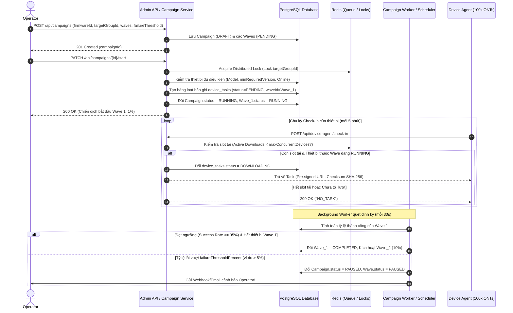
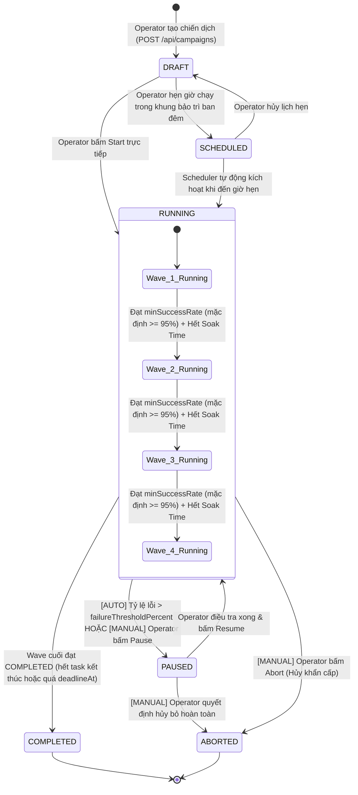

# CẨM NANG CHI TIẾT DÀNH CHO THÀNH VIÊN C
## VAI TRÒ: CAMPAIGN ENGINE & CONCURRENCY ENGINEER
### Đề tài: Nền tảng triển khai cập nhật Firmware (DASAN Vietnam)

---

## 1. TỔNG QUAN VAI TRÒ & MỤC TIÊU CỐT LÕI

Thành viên C nắm giữ **"Bộ não điều phối" (Orchestration Engine)** của toàn bộ hệ thống. Nếu Thành viên A lo cấu trúc dữ liệu và Thành viên B lo việc thiết bị nhận lệnh, thì **Thành viên C chịu trách nhiệm trả lời bài toán: Làm sao đưa firmware an toàn tới 50.000 thiết bị mà không làm sập mạng, không làm mất kết nối của khách hàng và tự động dừng lại ngay khi có biến cố?**

* **Trọng số điểm quyết định:** 20% (Điều phối chiến dịch & Máy trạng thái) + 15% (Xử lý đồng thời & Giới hạn tải).
* **Slide phụ trách chính:**
  * **Slide 7:** Luồng 2 - Triển khai chiến dịch, Canary Waves (cộng dồn 1% → 10% → 50% → 100%) & Giới hạn tải `maxConcurrentDevices`
  * **Slide 8 (nửa trái):** Máy trạng thái chiến dịch (Campaign State Machine)
  * **Slide 9 (phần của C):** Thuật toán Tự động tạm dừng (Auto-pause), chỉ số Dashboard (Observability #11) & Xử lý đồng thời (Concurrency Control)
  *(Ghi chú: Slide 9 do B chủ trì Bảng tình huống lỗi, C ghép khối Auto-pause & dòng xung đột 2 chiến dịch.)*
* **File bàn giao:**
  * `diagrams/sequence_campaign_rollout.drawio` (Sơ đồ tuần tự triển khai chiến dịch)
  * `diagrams/campaign_state_machine.drawio` (Máy trạng thái chiến dịch)

---

## 2. CHI TIẾT 5 ĐẦU VIỆC BẮT BUỘC PHẢI HOÀN THÀNH

### ĐẦU VIỆC 1: Thiết kế Luồng Triển khai Chiến dịch (Sequence Diagram - Slide 7)

Thành viên C phải vẽ được sơ đồ tuần tự mô tả chính xác quá trình từ lúc Operator bấm nút đến khi các đợt cập nhật (waves) chạy xong.



---

### ĐẦU VIỆC 2: Thiết kế Chiến lược Chia đợt (Canary Wave Rollout Logic)

Hội đồng DASAN sẽ hỏi: *"Bạn chọn thiết bị cho từng đợt như thế nào?"*. Thành viên C phải trình bày được logic phân đợt chặt chẽ:

1. **Cấu hình các Wave tiêu chuẩn (tỷ lệ cộng dồn — quy ước Q1):**
   * **Wave 1 (Canary 1% - Thử nghiệm nhỏ):** ~100–500 thiết bị (cỡ đợt = 1%).
   * **Wave 2 (Cộng dồn 10% - Mở rộng an toàn):** thêm 9% (~5.000 thiết bị tổng).
   * **Wave 3 (Cộng dồn 50% - Triển khai diện rộng):** thêm 40% (~25.000 thiết bị tổng).
   * **Wave 4 (Cộng dồn 100% - Toàn bộ còn lại):** thêm 50% (toàn bộ thiết bị đủ điều kiện còn lại trong nhóm).
2. **Tiêu chí lựa chọn thiết bị cho Wave 1 (Rất quan trọng):**
   * **KHÔNG chọn ngẫu nhiên hoàn toàn:** Phải ưu tiên chọn thiết bị của nhân viên nội bộ ISP/Lab trước, hoặc các hộ gia đình ở khu vực có mật độ khiếu nại thấp.
   * **Đa dạng hóa phần cứng:** Trong 1% đó, phải có đủ đại diện của các batch phần cứng sản xuất ở các năm khác nhau (Hardware Revisions).
   * **Loại trừ khách hàng VIP:** Tuyệt đối không đưa các thiết bị của cơ quan nhà nước, bệnh viện, khách hàng doanh nghiệp thuê kênh riêng (Leased Line) vào Wave 1 và Wave 2.
3. **Điều kiện chuyển Wave (Promotion Gate):**
   * Không chuyển wave ngay lập tức khi vừa nạp xong: Phải có **thời gian ngâm (Bake Time / Soak Time)** ít nhất **2 đến 4 giờ** để theo dõi xem thiết bị có bị rớt mạng chập chờn hay memory leak không.
   * Tỷ lệ thành công của Wave trước phải đạt $\ge 95\%$ (hoặc cấu hình theo yêu cầu của Operator).

---

### ĐẦU VIỆC 3: Thiết kế Máy trạng thái Chiến dịch (Campaign State Machine - Slide 8 & 9)

Thành viên C phải làm rõ các trạng thái và **Ai/Cái gì kích hoạt (Trigger)** từng bước:



* **Quy tắc chuyển trạng thái hợp lệ:**
  * Không cho phép nhảy cóc từ `DRAFT` sang `COMPLETED`.
  * Khi chiến dịch đang ở trạng thái `PAUSED` hoặc `ABORTED`, hệ thống **ngừng cấp task mới** cho các thiết bị check-in tiếp theo.

---

### ĐẦU VIỆC 4: Thuật toán Tự động Tạm dừng (Auto-pause Engine)

Đề bài yêu cầu: *"Nếu tỷ lệ lỗi vượt `failureThresholdPercent`, chiến dịch tự tạm dừng và cảnh báo OPERATOR. Xác định cách tính tỷ lệ lỗi và thời điểm đánh giá tỷ lệ này."*

Thành viên C cần trình bày công thức và cơ chế đánh giá như sau:

#### 1. Công thức tính tỷ lệ lỗi:
$$\text{CurrentFailureRate} = \frac{\text{Count}(\text{FAILED}_{final}) + \text{Count}(\text{TIMEOUT}_{final}) + \text{Count}(\text{ROLLED\_BACK})}{\text{Tổng số task đã ở trạng thái kết thúc cuối cùng trong Wave hiện tại}} \times 100\%$$

> **Lưu ý cốt lõi:** Mẫu số **KHÔNG** phải là tổng số thiết bị của chiến dịch, mà là **tổng số task đã ở trạng thái kết thúc cuối cùng** (`SUCCESS`, `ROLLED_BACK`, hoặc `FAILED`/`TIMEOUT` đã hết 3 lượt retry) trong Wave đang chạy — task đang chờ retry không bị tính vào lỗi. Nếu lấy tổng thiết bị làm mẫu số thì ở đầu wave tỷ lệ lỗi sẽ luôn bị tính sai lệch.

#### 2. Điều kiện kích hoạt đánh giá (Cold-start Guard):
* **Nguyên tắc cỡ mẫu tối thiểu:** Chỉ bắt đầu tính tỷ lệ lỗi sau khi có **ít nhất $N$ thiết bị hoàn tất** (ví dụ: $N = 50$ hoặc tối thiểu 10% số thiết bị của wave).
* *Lý do:* Nếu vừa chạy 2 thiết bị mà cả 2 đều rớt mạng tạm thời $\to$ tỷ lệ lỗi = 100% $\to$ Nếu không có cỡ mẫu tối thiểu, hệ thống sẽ bị "báo động giả" và dừng oan chiến dịch.

#### 3. Tần suất đánh giá:
* Background Worker chạy mỗi **30 giây** quét bảng `device_tasks` để tính toán.
* Nếu $\text{CurrentFailureRate} > \text{failureThresholdPercent}$:
  1. Đổi ngay `campaigns.status = PAUSED`.
  2. Đổi `campaign_waves.status = PAUSED`.
  3. Gửi thông báo khẩn (WebSocket/Alert) lên Dashboard của Operator.
  4. Các thiết bị đang tải dở vẫn được tiếp tục; các thiết bị check-in sau sẽ nhận phản hồi `"NO_TASK"`.

---

### ĐẦU VIỆC 5: Xử lý Đồng thời & Giới hạn Tải (Concurrency & Rate Limiting)

Hội đồng sẽ hỏi sâu về 2 bài toán thực tế ở mục 9 và 10 trong đề bài:

#### 1. Xử lý 2 Operator cùng bấm Start 2 chiến dịch có chung thiết bị (Mục 9)
* **Quy tắc nghiệp vụ:** Một thiết bị tại một thời điểm **tuyệt đối chỉ được nhận tối đa 1 tác vụ cập nhật firmware**.
* **Giải pháp kỹ thuật của Thành viên C:**
  * **Giải pháp 1 (Application level - Distributed Lock):** Khi Operator bấm Start, hệ thống dùng **Redis Distributed Lock (Redlock)** với key `lock:group:{groupId}` hoặc `lock:device:{deviceId}`. Nếu chiến dịch B cố tình chọn thiết bị đang bị lock bởi chiến dịch A $\to$ Bị từ chối ngay với mã lỗi `409 Conflict`.
  * **Giải pháp 2 (Database level - Partial Unique Index):** Tạo chỉ mục duy nhất có điều kiện trên PostgreSQL/MySQL:
    ```sql
    CREATE UNIQUE INDEX uq_device_active_task 
    ON device_tasks (deviceId) 
    WHERE status IN ('PENDING', 'DOWNLOADING', 'INSTALLING', 'VERIFYING');
    ```
    $\to$ Ràng buộc cứng này đảm bảo dù có race-condition ở tầng web server thì database cũng lập tức chặn đứng, không bao giờ tạo được 2 task active cho cùng 1 thiết bị.

#### 2. Kiểm soát tải tải xuống (`maxConcurrentDevices` - Mục 10)
* **Vấn đề:** 50.000 thiết bị cùng tải file 50MB cùng lúc sẽ làm sập băng thông ISP và đường truyền lưu trữ ($50.000 \times 50\text{MB} = 2.5\text{TB}$).
* **Giải pháp của Thành viên C:**
  * Áp dụng thuật toán **Redis Semaphore theo từng chiến dịch** (`sem:campaign:{id}`): Cấp đúng `maxConcurrentDevices` token (ví dụ: 500 tokens).
  * Khi thiết bị check-in: Kiểm tra Redis, nếu còn token thì cấp Pre-signed URL, đổi task sang `DOWNLOADING` và trừ 1 token.
  * Khi thiết bị báo đã tải xong (`stage = INSTALLING`) hoặc báo lỗi/timeout ở bước tải (`FAILED` / `TIMEOUT`) $\to$ Thu hồi lại 1 token về bucket ngay để nhường lượt tải cho thiết bị check-in kế tiếp (vì giới hạn này dùng để bảo vệ băng thông tải). Worker quét timeout sẽ thu hồi token nếu thiết bị im lặng quá 15 phút.

---

## 3. CHECKLIST NỘI DUNG CẦN ĐƯA LÊN SLIDE THUYẾT TRÌNH

### Slide 7: Luồng 2 - Triển khai chiến dịch & Canary Waves
- [ ] Chèn sơ đồ Sequence Diagram: Luồng từ Operator bấm Start $\to$ Lọc thiết bị $\to$ Tạo tasks $\to$ Mở Wave 1 $\to$ Thiết bị check-in nhận task.
- [ ] Bảng mô tả 4 đợt cập nhật: 1% $\to$ 10% $\to$ 50% $\to$ 100%.
- [ ] 3 gạch đầu dòng giải thích **Logic chọn thiết bị cho Wave 1**: Tránh khách hàng VIP, ưu tiên thiết bị nội bộ, đa dạng hóa các đời phần cứng.
- [ ] Tiêu chuẩn chuyển Wave: Ngưỡng thành công $\ge 95\%$ kèm thời gian ngâm (Soak time 2-4h).

### Slide 9: Xử lý lỗi chiến dịch, Tự động tạm dừng & Xử lý đồng thời
- [ ] Sơ đồ Máy trạng thái Chiến dịch (Campaign State Machine) với đầy đủ các trigger (Operator vs. Auto Worker).
- [ ] Công thức tính tỷ lệ lỗi $\text{FailureRate}$ kèm lời giải thích về **cỡ mẫu tối thiểu** để tránh báo động giả.
- [ ] Giải pháp chống xung đột đồng thời 2 chiến dịch: **Redis Lock** + **Partial Unique Index** trên DB.
- [ ] Cơ chế điều tiết giới hạn tải `maxConcurrentDevices` bằng **Redis Token Bucket**.

---

## 4. BỘ CÂU HỎI VẤN ĐÁP (Q&A) DỰ KIẾN KHI THUYẾT TRÌNH

1. **Hỏi:** *Khi hệ thống tự động tạm dừng (Auto-pause), những thiết bị đang tải dở firmware (DOWNLOADING) sẽ được xử lý như thế nào?*
   * **Trả lời:** Hệ thống cho phép các thiết bị đang tải dở tiếp tục tải và hoàn tất quá trình cài đặt/báo cáo kết quả bình thường. Lệnh Auto-pause chỉ có hiệu lực chặn cấp task mới cho các thiết bị check-in sau đó. Điều này giúp không lãng phí băng thông đã tải và thu thập thêm dữ liệu lỗi thực tế từ các thiết bị đang chạy dở.
2. **Hỏi:** *Tại sao bạn lại cần thời gian ngâm (Soak time) giữa các đợt thay vì chuyển đợt ngay khi đạt 95% thành công?*
   * **Trả lời:** Vì có những lỗi nghiêm trọng như rò rỉ bộ nhớ (memory leak), treo thiết bị sau một thời gian hoạt động hoặc lỗi định tuyến ngầm không xuất hiện ngay sau khi khởi động. Thời gian ngâm 2-4 giờ ở đợt 1% và 10% là tiêu chuẩn an toàn viễn thông bắt buộc để đảm bảo tính ổn định bền vững trước khi mở rộng ra 50% hay 100%.
3. **Hỏi:** *Nếu Redis bị sập thì cơ chế giới hạn tải `maxConcurrentDevices` có bị vô hiệu hóa làm sập hệ thống không?*
   * **Trả lời:** Nếu Redis gặp sự cố, hệ thống áp dụng cơ chế Fallback: Đếm trực tiếp số lượng bản ghi `status = 'DOWNLOADING'` trong cơ sở dữ liệu PostgreSQL (nhờ có index sẵn). Dù truy vấn DB chậm hơn in-memory Redis, nó vẫn bảo vệ được hạ tầng mạng không bị tải ồ ạt.
