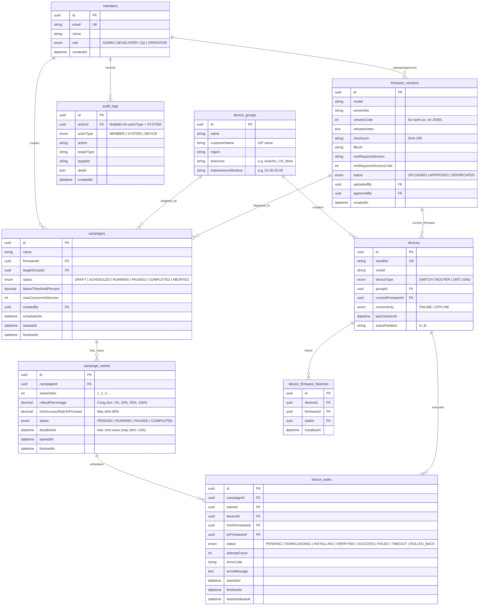
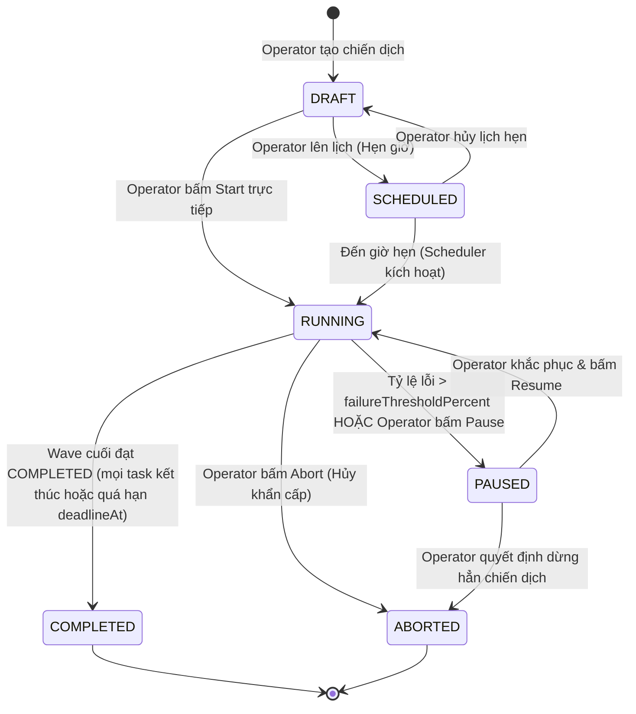
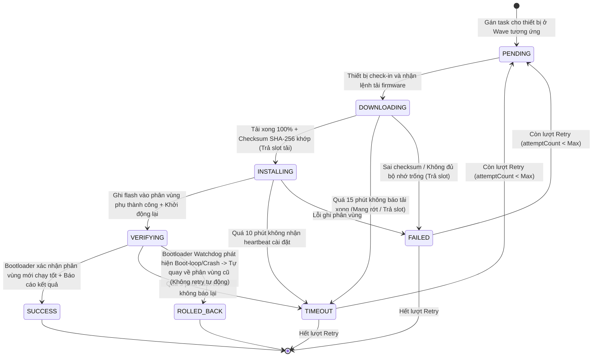

# BẢN ĐẶC TẢ & THIẾT KẾ HỆ THỐNG CHI TIẾT
## ĐỀ BÀI: NỀN TẢNG TRIỂN KHAI CẬP NHẬT FIRMWARE (FIRMWARE ROLLOUT PLATFORM)
**Doanh nghiệp:** DASAN Vietnam · **Track:** System Design (OJT 2026 KITS Hanoi)

---

## 1. TỔNG HỢP CÁC QUYẾT ĐỊNH THIẾT KẾ CỐT LÕI (DESIGN DECISIONS & TRADE-OFFS)

| Hạng mục | Quyết định kỹ thuật được chọn | Phương án bị loại & Lý do loại trừ |
| :--- | :--- | :--- |
| **Mô hình Wave (Đợt cập nhật)** | **Tách bảng riêng `campaign_waves`** (1-N với `campaigns`). | *Loại: Lưu mảng JSON trong `campaigns`* vì khó ràng buộc dữ liệu, không thể join trực tiếp để thống kê tốc độ/tỷ lệ lỗi từng wave, khó mở rộng retry per wave. |
| **Cơ chế giao tiếp (Push vs. Pull)** | **PULL thuần túy kết hợp Random Jitter (±30s)**. Thiết bị ONT/ONU gửi POST `/api/device-agent/check-in` mỗi 5 phút. | *Loại: PUSH thuần túy* vì thiết bị nằm sau Firewall/NAT của ISP, IP động, server không thể chủ động kết nối vào. *Loại: Hybrid (MQTT/TR-069)* vì tốn tài nguyên duy trì 100k kết nối persistent không cần thiết khi chu kỳ check-in 5 phút là đủ đáp ứng SLA. |
| **An toàn phía thiết bị** | **Dual-Bank (Phân vùng A/B) + Hardware Watchdog Timer**. | *Loại: Single-Bank Recovery ROM* vì nếu mất điện giữa chừng khi flash ROM chính thiết bị sẽ bị "brick" cứng, phải kỹ sư đến tận nhà nạp lại chip. |
| **Bảo mật & Xác thực** | **Tách 2 lớp:**<br>- Admin/Operator: **JWT Bearer + RBAC**.<br>- Thiết bị (Device Agent): **mTLS (Mutual TLS) hoặc HMAC-SHA256(`serialNo + timestamp + nonce`)** chống replay với secret key nạp sẵn trong phần cứng/flash. | *Loại: Dùng JWT cho thiết bị* vì thiết bị không có tài khoản/phiên đăng nhập người dùng; không thể xoay vòng token phức tạp; nguy cơ lộ token diện rộng. |
| **Tải file Firmware (Offloading)** | **Direct Download qua Object Storage (S3/MinIO) + CDN** bằng **Pre-signed URL** ngắn hạn (15-30 phút). Backend chỉ trả metadata & URL. | *Loại: Tải qua Backend API trung gian* vì 10.000 thiết bị đồng thời x 50MB sẽ bóp nghẹt băng thông của API Gateway/Server và làm sập hệ thống check-in. |
| **Tính năng AI tích hợp** | **Phương án C kết hợp B:** Phân cụm/phân loại log lỗi thiết bị (Error Log Clustering), xác định nguyên nhân gốc (Root Cause) và đánh giá mức độ rủi ro hệ thống để đề xuất hành động cho Operator. | *Loại: Tóm tắt Release Note đơn thuần (Phương án A)* vì giá trị kỹ thuật thấp, ít đóng góp vào an toàn vận hành. |

---

## 2. THIẾT KẾ DỮ LIỆU (ERD) & GIẢI TRÌNH BƯỚC 1

### 2.1. Cấu trúc bảng dữ liệu tối ưu



### 2.2. Trả lời 5 câu hỏi thiết kế bắt buộc trên Slide ERD
1. **Mô hình hóa đợt cập nhật bằng bảng riêng hay một phần chiến dịch?**
   * **Trả lời:** Tách bảng riêng `campaign_waves`. Một chiến dịch gồm nhiều đợt kế tiếp nhau (Canary 1% → 10% → 50% → 100%). Tách bảng giúp cấu hình điều kiện kích hoạt đợt kế tiếp độc lập, quản lý retry riêng theo từng đợt và theo dõi chính xác tiến độ mà không làm phình to bản ghi `campaigns`.
2. **Trạng thái chiến dịch và trạng thái thiết bị lưu ở đâu? Có giống nhau không?**
   * **Trả lời:** Hoàn toàn tách biệt.
     * `campaigns.status` (vĩ mô - Operator kiểm soát): `DRAFT`, `SCHEDULED`, `RUNNING`, `PAUSED`, `COMPLETED`, `ABORTED`.
     * `device_tasks.status` (vi mô - Thiết bị thực thi): `PENDING`, `DOWNLOADING`, `INSTALLING`, `VERIFYING`, `SUCCESS`, `FAILED`, `TIMEOUT`, `ROLLED_BACK`.
3. **Những trường nào được tính toán từ dữ liệu khác và không nên lưu trữ?**
   * **Trả lời:** Các chỉ số: *Tỷ lệ thành công hiện tại (Current Success Rate)*, *Tỷ lệ lỗi (Failure Rate)*, *Số lượng thiết bị đang chạy đồng thời (Current Active Downloads)*, *Tổng số thiết bị hoàn thành*. Các chỉ số này được tính toán động (aggregate queries từ `device_tasks` hoặc lưu tạm trong Redis Cache) để bảo đảm nguyên tắc Single Source of Truth, tránh sai lệch dữ liệu khi có nhiều worker xử lý đồng thời.
4. **Làm thế nào để lưu lịch sử mọi firmware mà thiết bị từng chạy?**
   * **Trả lời:** Sử dụng bảng `device_firmware_histories` (ghi nhận mỗi khi `device_tasks` chuyển sang trạng thái `SUCCESS`) kết hợp với việc giữ lại toàn bộ lịch sử các `device_tasks` cũ (không bao giờ xóa cứng dữ liệu tác vụ).
5. **Những bảng nào tăng nhanh nhất và chiến lược Index/Archiving?**
   * **Trả lời:** Hai bảng tăng nhanh nhất là `device_tasks` (với 100k thiết bị, mỗi năm có 4-6 chiến dịch thì tăng ~500.000 dòng/năm) và `audit_logs`.
   * **Chiến lược:**
     * Tạo Composite Index: `(campaignId, status)`, `(deviceId, status)`, `(waveId, status)` để phục vụ scheduler quét tác vụ.
     * Tạo Partial Unique Index trên `device_tasks`: Mỗi thiết bị chỉ có duy nhất 1 task ở trạng thái đang chạy (`PENDING`, `DOWNLOADING`, `INSTALLING`, `VERIFYING`) để ngăn race-condition.
     * Phân vùng bảng (Partitioning) theo `campaignId` hoặc theo năm/quý; lưu trữ lạnh (Cold Storage Archiving) các task của chiến dịch đã kết thúc trên 1 năm.

---

## 3. KIẾN TRÚC HỆ THỐNG & LUỒNG XỬ LÝ (BƯỚC 2)

### 3.1. Sơ đồ khối kiến trúc (Component Diagram)
* **Client Layer:**
  * Admin Portal (Web UI cho Developer, QA, Operator, Admin).
  * 100.000 Edge Devices (ONT/ONU/Switch/Router) tích hợp lightweight C/Rust Device Agent.
* **Gateway & API Layer:**
  * API Gateway: Reverse Proxy, SSL Termination, phân luồng xác thực (Admin dùng JWT; Thiết bị dùng mTLS hoặc HMAC-SHA256).
  * Admin Service: CRUD Firmware, duyệt 4-mắt, cấu hình Chiến dịch & Giám sát tiến độ.
  * Device Ingestion Service: Chuyên xử lý `check-in` và nhận `result`, tối ưu hóa xử lý cao tải không trạng thái (stateless).
* **Storage & Asynchronous Layer:**
  * Primary Database: PostgreSQL/MySQL lưu thông tin thực thể, ERD.
  * Cache & In-Memory Store: Redis (quản lý Rate Limit, Token Bucket `maxConcurrentDevices`, Distributed Lock).
  * Message Queue / Background Worker: RabbitMQ/Kafka + Celery/Hangfire (quét timeout, kích hoạt wave tiếp theo, tính toán tự động pause).
  * Firmware Storage: MinIO / AWS S3 kết hợp Cloudflare/Local ISP CDN.

### 3.2. Máy trạng thái (State Machines)

#### A. State Machine: Campaign


#### B. State Machine: Device Task


---

## 4. BÀI TOÁN QUY MÔ, NĂNG LỰC & ĐIỂM NGHẼN (CAPACITY ESTIMATION)

| Chỉ số | Phép tính toán học & Lập luận | Kết quả |
| :--- | :--- | :--- |
| **RPS Check-in trung bình** | $100.000 \text{ thiết bị} / (5 \times 60 \text{ giây}) = 100.000 / 300$ | **$\approx 333$ Requests/giây** |
| **RPS Check-in lúc cao điểm (Thundering Herd)** | Xảy ra khi mất điện diện rộng/mạng ISP phục hồi: Giả định 30% thiết bị check-in trong 30s + nhân hệ số an toàn x3 | **$\approx 1.500 - 3.000$ RPS** |
| **Lượng dữ liệu Wave 10%** | $50.000 \text{ thiết bị (chiến dịch lớn)} \times 10\% = 5.000 \text{ thiết bị}$<br>$5.000 \times 50 \text{ MB}$ | **$250.000 \text{ MB} \approx 250 \text{ GB}$** |
| **Thời gian hoàn thành triển khai** | Giả định đặt `maxConcurrentDevices = 500`.<br>Băng thông tải trung bình 5 MB/s (10s tải + ~3 phút cài/reboot/verify = ~3,2 phút/thiết bị).<br>Hơn nữa thông lượng bị giới hạn bởi chu kỳ check-in 5 phút và thời gian ngâm (Soak Time 2–4 giờ giữa Wave 1, 2). | **~2–3 giờ** cho phần tải & cài 50.000 máy *(tổng thời gian chiến dịch gồm Soak Time: **~6–8 giờ**)* |
| **Băng thông Egress lúc cao điểm** | 500 lượt tải đồng thời $\times$ 5 MB/s | **$\approx 2,5$ GB/s ($\approx 20$ Gbps)** $\to$ Bắt buộc dùng Object Storage + CDN |
| **Tăng trưởng bảng `device_tasks`** | Giả sử 1 năm cập nhật 4 lần cho 100.000 thiết bị. Cộng thêm các lượt retry (trung bình 1.2 task/thiết bị) | **$\approx 480.000 - 600.000$ records/năm** |

* **Điểm nghẽn xác định & Giải pháp:**
  1. *Điểm nghẽn DB Write:* Hàng ngàn thiết bị check-in cùng lúc ghi cập nhật `lastCheckInAt` $\to$ **Giải pháp:** Cập nhật `lastCheckInAt` vào Redis memory trước, dùng Background Worker gom batch ghi DB sau mỗi 30-60 giây.
  2. *Điểm nghẽn Băng thông File Firmware:* 5.000 thiết bị tải đồng thời làm sập mạng $\to$ **Giải pháp:** Dùng cơ chế Redis Semaphore (`sem:campaign:{id}`) để giới hạn chính xác số lượt cấp Pre-signed URL không vượt quá `maxConcurrentDevices` (cấp khi $\to$ `DOWNLOADING`, trả slot khi báo `INSTALLING` hoặc lỗi/timeout ở bước tải), kết hợp Cloudflare/Local ISP CDN để gánh 20 Gbps egress.
  3. *Kịch bản tăng quy mô gấp 10 lần (1.000.000 thiết bị):* ~3.333 RPS trung bình, ~15.000–30.000 RPS cao điểm $\to$ Scale ngang stateless Device Ingestion Service sau Load Balancer, Partition/Sharding bảng `device_tasks` theo `campaignId` hoặc thời gian, nâng cấp Redis Cluster và dùng nhiều PoP CDN theo vùng ISP.

---

## 5. TÍNH NĂNG AI / LLM: PHÂN LOẠI LỖI & ĐÁNH GIÁ RỦI RO CHIẾN DỊCH

### 5.1. Thiết kế Prompt chuẩn kỹ thuật
* **Mục đích:** Nhóm hàng trăm log lỗi gửi về từ thiết bị, suy luận nguyên nhân gốc rễ và đánh giá mức độ rủi ro để đưa ra khuyến nghị dừng/tiếp tục chiến dịch cho Operator.
* **Input mẫu (Đã ẩn danh hóa):**
  ```json
  {
    "campaignId": "cmp-8921",
    "firmwareVersion": "v2.4.1",
    "targetModel": "DASAN-H660GM",
    "totalFailedDevices": 42,
    "errorSamples": [
      {"serial": "DSN-01", "stage": "VERIFYING", "code": "ERR_WATCHDOG_BOOT_TIMEOUT", "log": "Kernel panic: unable to mount root fs on partition B"},
      {"serial": "DSN-02", "stage": "VERIFYING", "code": "ERR_WATCHDOG_BOOT_TIMEOUT", "log": "Kernel panic: unable to mount root fs on partition B"}
    ]
  }
  ```
* **Output mong đợi (JSON Schema cố định — *Minh họa cấu trúc; khi nộp bài D phải chạy với model AI thật và chụp Input/Output thực tế*):**
  ```json
  {
    "primaryRootCause": "Lỗi phân vùng Partition B trên phần cứng hoặc firmware image thiếu driver mount rootfs",
    "affectedScope": "Các thiết bị dòng DASAN-H660GM gặp lỗi ERR_WATCHDOG_BOOT_TIMEOUT",
    "riskLevel": "CRITICAL",
    "autoPauseRecommended": true,
    "suggestedOperatorAction": "Tạm dừng chiến dịch ngay lập tức. Yêu cầu QA kiểm tra lại file firmware v2.4.1 trên thiết bị mẫu tại lab."
  }
  ```

### 5.2. Quản trị rủi ro & Fallback AI
* **Human-in-the-loop:** Kết quả AI chỉ hiển thị dạng "Cảnh báo gợi ý" trên Dashboard. Mọi quyết định Abort/Rollback vẫn do Operator click xác nhận.
* **AI Failure Fallback & Tính độc lập:** Nếu dịch vụ OpenAI/Gemini bị timeout (quá 5 giây) hoặc trả về định dạng sai JSON Schema $\to$ Backend bắt exception và chỉ ẩn khung gợi ý AI trên Dashboard; **bộ máy Auto-pause cơ học của chiến dịch (C) chạy hoàn toàn độc lập, không phụ thuộc vào AI**.
* **Nhật ký chỉnh sửa AI (Case Study đưa lên Slide & `docs/prompt-log.md`):**
  1. *Lỗi tự suy diễn (Hallucination):* Ở lần thử đầu, AI trả `affectedScope = "Các thiết bị sản xuất trước năm 2024"` dù input không hề chứa năm sản xuất. Nhóm đã sửa Prompt thêm ràng buộc *"chỉ suy luận từ các trường có trong input"* và thêm bước backend validate.
  2. *Lỗi hành động quá quyền:* Ban đầu AI đề xuất *"Tự động rollback toàn bộ các thiết bị đang online"*. Nhóm phản biện và khóa lại: chỉ cho phép AI đề xuất khuyến nghị cho con người.

---

## 6. PHÂN CÔNG CÔNG VIỆC NHÓM 4 THÀNH VIÊN & DÀN Ý 16 SLIDE

### 6.1. Ma trận phân công trách nhiệm (4 thành viên — đồng nhất với `DASAN_OJT1_Team_Role_Assignment.md`)
* **Thành viên A (Domain & Data Architect):**
  * Chủ trì ERD, cấu trúc quan hệ, trả lời 5 câu hỏi thiết kế Bước 1.
  * Phụ trách Luồng 1 — Phát hành & Phê duyệt 4-mắt (Sequence Release & Approval), ma trận quy tắc tương thích.
* **Thành viên B (Device & Protocol Lead):**
  * Chủ trì Sơ đồ thành phần tổng quan (Architecture), Luồng 2 — Check-in & Tải firmware (Sequence Check-in), phân tích cơ chế Pull + Random Jitter.
  * Thiết kế Máy trạng thái Tác vụ thiết bị (Device Task State Machine), cơ chế Dual-Bank A/B, tính lũy đẳng (Idempotency), chủ trì Bảng tình huống lỗi (Slide 9) và Phác thảo API (Slide 12).
* **Thành viên C (Campaign Engine & Concurrency Lead):**
  * Chủ trì Bộ máy điều phối chiến dịch (Sequence Campaign Rollout, Wave Rollout, Auto-pause logic).
  * Xử lý xung đột đồng thời (Concurrency Control), giới hạn tải (`maxConcurrentDevices`), Máy trạng thái Chiến dịch, Observability (#11) và Bonus #14 (Khung giờ bảo trì).
* **Thành viên D (Reliability, Scale, Security & AI Lead - Điều phối Slide):**
  * Tính toán thông số Năng lực & Quy mô (Capacity Estimation + kịch bản 10x), xác định điểm nghẽn.
  * Thiết kế Ma trận phân quyền RBAC, xác thực thiết bị, Audit Trail và Bonus #13 (Rollback hàng loạt sau chiến dịch).
  * Phụ trách Tính năng AI (chạy model thật, Prompt Log, Schema, Fallback) + Tổng hợp 16 Slide PPT + Dựng Mock API Skeleton.

### 6.2. Cấu trúc 16 Slide chuẩn bị thuyết trình
1. **Slide 1: Trang bìa** (Tên đề tài, thành viên, DASAN Vietnam, KITS 2026).
2. **Slide 2: Xác định vấn đề** (Thực trạng cập nhật thủ công, rủi ro mất mạng diện rộng, phạm vi bài toán).
3. **Slide 3: Tác nhân & Bảng thuật ngữ** (Admin, Developer, QA, Operator, Device; giải thích Check-in, Canary Wave, Dual-bank).
4. **Slide 4: Mô hình miền dữ liệu (ERD)** (Trình chiếu ERD, trả lời 5 câu hỏi thiết kế cốt lõi).
5. **Slide 5: Kiến trúc tổng quan hệ thống** (Sơ đồ khối, luận điểm chọn cơ chế Pull thay vì Push, tách tải Storage S3/CDN).
6. **Slide 6: Luồng 1 - Phát hành & Phê duyệt** (Sequence diagram, nguyên tắc 4 mắt: Dev tải lên, QA duyệt; quy tắc tương thích firmware).
7. **Slide 7: Luồng 2 - Triển khai chiến dịch & Chia đợt** (Sequence diagram, cơ chế chia Canary Wave cộng dồn 1% $\to$ 10% $\to$ 50% $\to$ 100%, Concurrency Control & `maxConcurrentDevices` — *C*).
8. **Slide 8: Máy trạng thái (State Machines)** (Song song 2 máy trạng thái: trái là Campaign Lifecycle — *C*, phải là Device Task Lifecycle — *B*).
9. **Slide 9: Bảng tình huống lỗi & Tự động bảo vệ** (Bảng *Xảy ra gì / Phát hiện thế nào / Khôi phục ra sao* + Dual-Bank A/B — *B chủ trì*, kết hợp khối Auto-pause & chỉ số Dashboard — *C*, và Rollback sau chiến dịch — *D*).
10. **Slide 10: Quy mô & Năng lực (Capacity Planning)** (Bảng tính toán 333 RPS, 250 GB/wave, 20 Gbps egress, giải pháp triệt tiêu Thundering Herd bằng Jitter & kịch bản tăng 10x — *D*).
11. **Slide 11: Bảo mật, Phân quyền & Audit Trail** (Ma trận RBAC, xác thực thiết bị bằng mTLS/HMAC, bảng ghi vết kiểm toán — *D*).
12. **Slide 12: Phác thảo API (API Outline)** (Chuẩn RESTful, chi tiết 3 endpoint cốt lõi: Check-in, Report Result, Create Campaign — *B phụ trách*).
13. **Slide 13: Ứng dụng AI / LLM** (Prompt phân loại lỗi, JSON output, cơ chế Human-in-the-loop, ca sửa lỗi AI trong thực tế).
14. **Slide 14: Đánh đổi thiết kế & Lộ trình MVP** (Bảng 3 đánh đổi lớn; tính năng bàn giao ngay trong MVP vs tính năng mở rộng).
15. **Slide 15: Phân công & Đóng góp cá nhân** (Chi tiết vai trò A, B, C, D; bài học kinh nghiệm về System Design).
16. **Slide 16: Hỏi đáp (Q&A) & Demo Mock API** (Lời cảm ơn, liên kết mã nguồn sơ đồ / Swagger UI).
