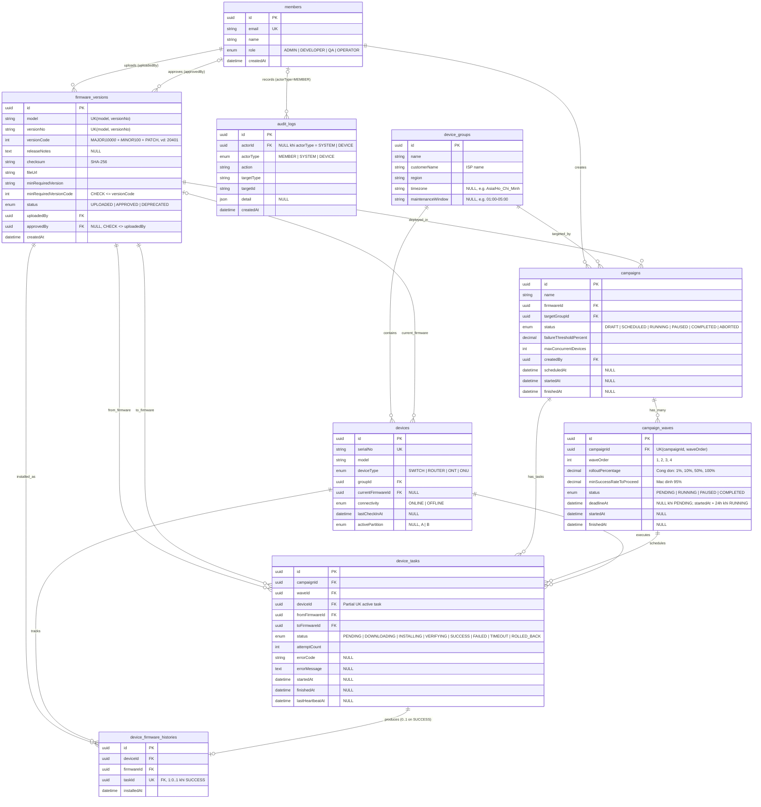
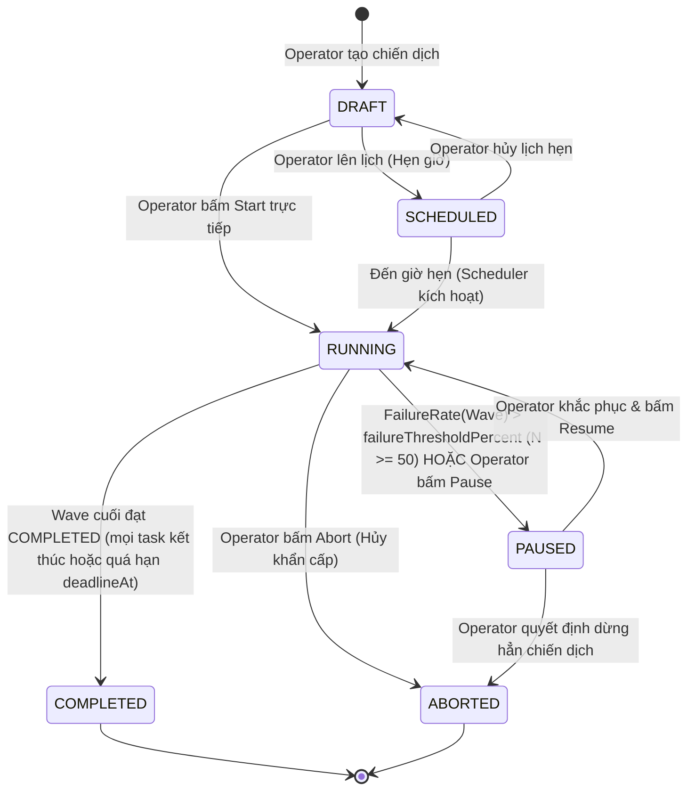
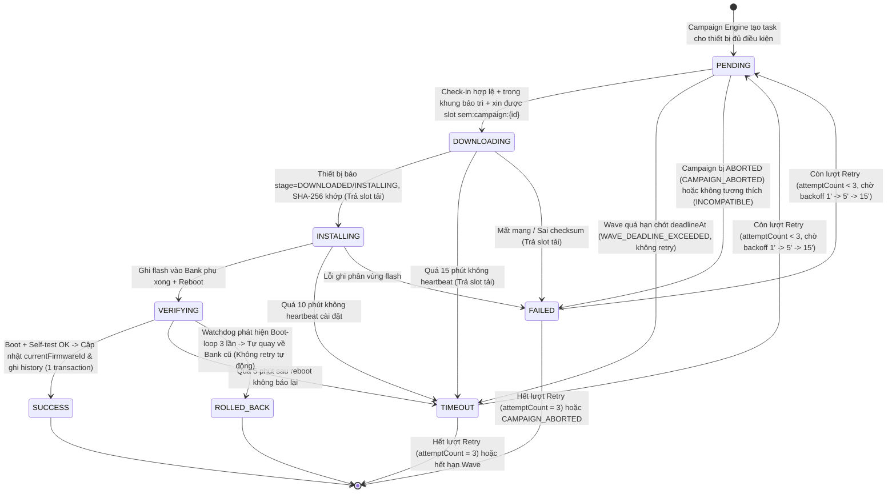

# BẢN ĐẶC TẢ & THIẾT KẾ HỆ THỐNG CHI TIẾT (ĐÃ ĐỒNG BỘ CROSS-REVIEW A · B · C · D)
## ĐỀ BÀI: NỀN TẢNG TRIỂN KHAI CẬP NHẬT FIRMWARE (FIRMWARE ROLLOUT PLATFORM)
**Doanh nghiệp:** DASAN Vietnam · **Track:** System Design (OJT 2026 KITS Hanoi)

---

## 1. TỔNG HỢP CÁC QUYẾT ĐỊNH THIẾT KẾ CỐT LÕI (DESIGN DECISIONS & TRADE-OFFS)

| Hạng mục | Quyết định kỹ thuật được chọn | Phương án bị loại & Lý do loại trừ |
| :--- | :--- | :--- |
| **Mô hình Wave (Đợt cập nhật)** | **Tách bảng riêng `campaign_waves`** (1–N với `campaigns`, tỷ lệ cộng dồn `1% → 10% → 50% → 100%`). | *Loại: Lưu mảng JSON trong `campaigns`* vì không đặt được FK/Unique constraint, không thể join trực tiếp SQL với `device_tasks` để tính tỷ lệ lỗi từng wave, dễ gây tranh chấp khóa ghi. |
| **Cơ chế giao tiếp & Chống Thundering Herd** | **PULL thuần túy (`POST /api/device-agent/check-in` mỗi 300s)**:<br>- Lúc khởi động / mất điện khôi phục / lỗi mạng: **Lệch pha theo `serialNo` (`hash(serialNo) mod 300s`) / Random Boot Delay `[0, 300s]` + Full-Jitter Exponential Backoff**.<br>- Khi chạy ổn định: **Random Jitter `±30s`** + `nextCheckInSeconds` động từ server. | *Loại: PUSH thuần túy* vì thiết bị ONT/ONU nằm sau NAT/Firewall của ISP, IP động, server không thể mở kết nối vào. *Loại: Hybrid (MQTT/TR-069 persistent)* vì giữ 100.000 kết nối thường trực tốn tài nguyên trong khi độ trễ ≤ 5 phút đã đáp ứng tốt bài toán cập nhật firmware. |
| **An toàn phía thiết bị** | **Dual-Bank (Phân vùng A/B) + Hardware Watchdog Timer** (giữ nguyên bản cũ ở Bank A cho tới khi Bank B vượt qua `VERIFYING`). | *Loại: Single-Bank Recovery ROM* vì mất điện giữa lúc ghi flash chính sẽ làm thiết bị "brick", buộc cử kỹ sư đến nhà thuê bao nạp lại chip. |
| **Bảo mật & Xác thực 2 miền** | **Tách biệt hoàn toàn 2 miền xác thực:**<br>- Web Admin/Operator: **JWT Bearer + RBAC (4 vai trò)**.<br>- Thiết bị cạnh: **HMAC-SHA256(`serialNo + timestamp + nonce + METHOD + PATH + SHA256(body)`)** với `secret` lưu tách biệt tại `device_credentials` / KMS + Redis Nonce chống replay (mTLS là lộ trình nâng cấp production). | *Loại: Dùng chung JWT cho thiết bị* vì thiết bị không có phiên đăng nhập người dùng; lộ khóa ký JWT hoặc token dài hạn gây rủi ro diện rộng; ký 6 thành phần HMAC khóa chặt cả nội dung body lẫn đường dẫn API. |
| **Tải file Firmware (Offloading)** | **Direct Download qua Object Storage (S3/MinIO) + CDN** bằng **Pre-signed URL** ngắn hạn (`TTL = 15 phút`), kiểm soát bằng Redis Semaphore `sem:campaign:{id}` (`maxConcurrentDevices`). | *Loại: Tải qua Backend API trung gian* vì 500 lượt tải × 5 MB/s = **20 Gbps** (2,5 TB/chiến dịch) sẽ làm nghẽn hoàn toàn API Gateway và đánh sập luồng check-in. |
| **Tính năng AI tích hợp** | **Phương án C (Error Log Clustering & Suggested Action):** Gom nhóm lỗi đã ẩn danh (`errorGroups[]`), phân vào 8 nhãn nguyên nhân gốc bằng JSON Schema chặt + 4 lớp kiểm chứng, chỉ hiển thị gợi ý tham khảo cho Operator; **Auto-pause cơ học chạy độc lập 100% với AI**. | *Loại: Tóm tắt Release Note đơn thuần (Phương án A)* vì ít đóng góp vào an toàn vận hành. *Loại: Đẩy log thô từng máy hoặc cho AI tự dừng/rollback* vì vượt ngữ cảnh token, rủi ro rò PII và nguy cơ hallucination/prompt injection gây dừng mạng oan. |

---

## 2. THIẾT KẾ DỮ LIỆU (ERD) & GIẢI TRÌNH BƯỚC 1

### 2.1. Cấu trúc bảng dữ liệu chuẩn hóa (Đồng bộ với `ERD/dasan_firmware_rollout.dbml`)



> **Ghi chú tách khóa thiết bị:** Khóa bí mật `secret` phục vụ ký `HMAC-SHA256` được lưu tách biệt tại kho khóa riêng (`device_credentials(deviceId, secret, createdAt)` / KMS), không đặt trên bảng `devices` để đảm bảo các API quản trị (`GET /api/devices`) không bao giờ đọc hoặc làm lộ secret.

### 2.2. Trả lời 5 câu hỏi thiết kế bắt buộc trên Slide ERD
1. **Mô hình hóa đợt cập nhật bằng bảng riêng hay một phần chiến dịch?**
   * **Trả lời:** Tách bảng riêng `campaign_waves` (`1:N` với `campaigns`). Cho phép cấu hình `minSuccessRateToProceed` và theo dõi `deadlineAt`, `startedAt`, `finishedAt` độc lập từng đợt (`1% → 10% → 50% → 100%`), đặt `UNIQUE(campaignId, waveOrder)` và join trực tiếp SQL với `device_tasks` để tính tỷ lệ lỗi từng wave mà không làm phình hay khóa bản ghi `campaigns`.
2. **Trạng thái chiến dịch và trạng thái thiết bị lưu ở đâu? Có giống nhau không?**
   * **Trả lời:** Hoàn toàn tách biệt ở 2 bảng thuộc 2 cấp độ khác nhau:
     * `campaigns.status` (cấp vĩ mô — điều phối): `DRAFT`, `SCHEDULED`, `RUNNING`, `PAUSED`, `COMPLETED`, `ABORTED`.
     * `device_tasks.status` (cấp vi mô — thực thi thiết bị): `PENDING`, `DOWNLOADING`, `INSTALLING`, `VERIFYING`, `SUCCESS`, `FAILED`, `TIMEOUT`, `ROLLED_BACK`.
3. **Những trường nào được tính toán từ dữ liệu khác và không nên lưu trữ?**
   * **Trả lời:** *Current Success Rate*, *Failure Rate*, *Current Active Downloads*, *Completed Devices*. Được tính động từ `device_tasks` (Single Source of Truth) và cache trên Redis; mẫu số chỉ đếm các task ở **trạng thái kết thúc cuối cùng** (`SUCCESS`, `ROLLED_BACK`, và `FAILED`/`TIMEOUT` đã hết 3 lượt retry — Q4).
4. **Làm thế nào để lưu lịch sử mọi firmware mà thiết bị từng chạy?**
   * **Trả lời:** Chỉ khi `device_tasks` vượt qua `VERIFYING` và đạt `SUCCESS`, backend mới thực hiện **1 DB Transaction nguyên tử**: đổi `device_tasks.status = 'SUCCESS'`, cập nhật `devices.currentFirmwareId = toFirmwareId` và `INSERT device_firmware_histories` (quan hệ `1 : 0..1` qua `UNIQUE(taskId)`). Các lần thử thất bại hoặc `ROLLED_BACK` được lưu đầy đủ vết tại `device_tasks` (không bao giờ xóa cứng).
5. **Những bảng nào tăng nhanh nhất và chiến lược Index/Archiving?**
   * **Trả lời:** Hai bảng tăng nhanh nhất là **`device_tasks`** (~`500.000 – 550.000` bản ghi/năm với 10 chiến dịch × 50.000 máy, retry tăng `attemptCount` trên cùng dòng) và **`audit_logs`** (~`2.500.000` dòng/năm ở cận trên nếu ghi đầy đủ sự kiện quản trị + mốc chuyển trạng thái tác vụ; **tuyệt đối không ghi check-in/heartbeat định kỳ** vào `audit_logs`).
   * **Chiến lược:**
     * 3 Composite Indexes: `(campaignId, status)`, `(deviceId, status)`, `(waveId, status)` trên `device_tasks`; `(targetType, targetId, createdAt)` trên `audit_logs`.
     * Partial Unique Index `uq_active_device_task ON device_tasks(deviceId) WHERE status IN ('PENDING', 'DOWNLOADING', 'INSTALLING', 'VERIFYING')` chống tuyệt đối 2 tác vụ chạy trùng trên 1 thiết bị.
     * Range Partitioning theo tháng/quý và Cold Storage Archiving (S3 Parquet / bảng lưu trữ lạnh) cho dữ liệu chiến dịch đã đóng trên 12 tháng.

---

## 3. KIẾN TRÚC HỆ THỐNG & LUỒNG XỬ LÝ (BƯỚC 2)

### 3.1. Sơ đồ khối kiến trúc (Component Diagram)
* **Client Layer:**
  * Admin Portal (Web UI cho `DEVELOPER`, `QA`, `OPERATOR`, `ADMIN`).
  * 100.000 Edge Devices (`ONT`, `ONU`, `SWITCH`, `ROUTER`) tích hợp lightweight Device Agent (Dual-Bank A/B + Watchdog).
* **Gateway & API Layer:**
  * API Gateway: Reverse Proxy, TLS Session Resumption, Rate Limiting 2 lớp (theo `serialNo` & nhóm ISP), tách 2 miền xác thực (`/api/*` dùng JWT; `/api/device-agent/*` dùng HMAC-SHA256 / mTLS).
  * Admin & Campaign Service: Quản lý Firmware (duyệt 4-mắt), điều phối Campaign/Wave, kiểm tra tương thích.
  * Device Ingestion Service (Stateless, Autoscale): Chuyên xử lý `check-in` và nhận `result` (`stage`).
* **Storage & Asynchronous Layer:**
  * Primary Database (PostgreSQL): Lưu trữ quan hệ chuẩn hóa, ràng buộc `CHECK` & Partial Unique Index.
  * In-Memory Store (Redis): Lưu tạm `lastCheckInAt` (batch flush 30–60s), Nonce chống replay, Semaphore `sem:campaign:{id}` (`maxConcurrentDevices`), Distributed Lock `Lock(targetGroupId)`, cache tiến độ Dashboard.
  * Background Workers:
    1. *Timeout Sweeper Worker:* Quét `lastHeartbeatAt` để đánh dấu `TIMEOUT` (15' tải / 10' cài / 5' verify), thu hồi slot tải bị rò và hết hạn wave quá `deadlineAt`.
    2. *Campaign Promotion & Auto-Pause Worker:* Đánh giá mỗi 30s để kích hoạt Auto-pause hoặc mở Wave kế tiếp sau Soak Time.
    3. *AI Classifier Worker (Async, Read-only):* Gom nhóm lỗi gửi LLM khi Campaign `PAUSED` hoặc Wave `COMPLETED`.
  * Firmware Storage: Object Storage (S3/MinIO) + Multi-PoP CDN phục vụ tải trực tiếp qua Pre-signed URL.

### 3.2. Máy trạng thái (State Machines)

#### A. State Machine: Campaign

> **Quy tắc dọn tác vụ khi `PAUSED` / `ABORTED`:**
> * Khi `PAUSED`: Ngừng cấp phát task `PENDING` mới ở bước check-in; các thiết bị đang dở `DOWNLOADING / INSTALLING / VERIFYING` vẫn được phép hoàn tất an toàn để không làm hỏng flash.
> * Khi `ABORTED`: Các thiết bị đang flash dở vẫn hoàn tất an toàn; toàn bộ task còn `PENDING` chưa bắt đầu được chuyển hàng loạt sang `FAILED` với `errorCode = 'CAMPAIGN_ABORTED'` (`finishedAt = NOW()`) nhằm **giải phóng ngay khóa `uq_active_device_task`**, giúp thiết bị sẵn sàng cho chiến dịch khắc phục tiếp theo mà không cần thêm giá trị enum ngoài đề bài.

#### B. State Machine: Device Task


---

## 4. BÀI TOÁN QUY MÔ, NĂNG LỰC & ĐIỂM NGHẼN (ĐỒNG BỘ `capacity_calc.py`)

| Chỉ số | Công thức & Giả định tường minh | Kết quả |
| :--- | :--- | :--- |
| **RPS Check-in trung bình** | $100.000 \text{ thiết bị} / 300\text{s}$ (1 lượt $\approx 1\text{ KB} \Rightarrow \sim 2,7\text{ Mbps}$) | **$\approx 333,33$ RPS** |
| **RPS Check-in cao điểm (Thundering Herd)** | Giả định sự cố điện/mạng làm $30\%$ fleet ($30.000$ máy) online lại trong $10–20\text{s}$ (tải API chỉ $\sim 24\text{ Mbps}$). Nhờ lệch pha `serialNo` + Full-Jitter trải trên $300\text{s}$, đỉnh thực tế giảm còn $\sim 433$ RPS. | **$1.500 – 3.000$ RPS** *(trước giảm tải)* |
| **Dữ liệu Wave 10% (Chiến dịch 50.000 máy)** | - Tính theo **mốc cộng dồn 10% (Q1)**: $5.000 \text{ máy} \times 50\text{ MB} = \mathbf{250\text{ GB}}$<br>- Tính riêng **Wave 2 (+9%)**: $4.500 \text{ máy} \times 50\text{ MB} = \mathbf{225\text{ GB}}$<br>- Toàn chiến dịch 50.000 máy: $\mathbf{2,5\text{ TB}}$ ($\sim 3,0\text{ TB}$ kèm hệ số retry $\times 1,2$) | **$250\text{ GB}$** *(cộng dồn 10%)* |
| **Băng thông Egress lúc cao điểm** | `maxConcurrentDevices` ($500$ slot) $\times 5\text{ MB/s}$ ($\approx 40\text{ Mbps}$/máy). Với ~50 PoP CDN, Origin chỉ phát $50 \times 50\text{ MB} = 2,5\text{ GB}$ (giảm tải Origin $\sim 1.000\times$). | **$2,5\text{ GB/s} = 20\text{ Gbps}$** $\to$ Bắt buộc CDN |
| **Thời gian hoàn thành chiến dịch 50.000 máy** | - Thực thi tải + flash + verify (3 phút/máy) cho 4 wave: **$\sim 30 – 49$ phút**.<br>- Cộng Soak Time ($2\text{h} \times 2$ wave đầu = $4\text{h}$): **$\sim 4,5 – 4,8$ giờ** cho các máy đang `ONLINE`.<br>- Nếu có $5\%$ máy `OFFLINE`: đạt **$\sim 8,0$ giờ** khi cấu hình hạn chót straggler `1h/wave`, hoặc tối đa **$100$ giờ** nếu chờ hết mặc định `deadlineAt = 24h/wave` (Q7). | **$\sim 4,8\text{h}$ (`ONLINE`) · $8\text{h}$ (`deadline 1h`) · tối đa $100\text{h}$ (`Q7 24h`)** |
| **Tăng trưởng dữ liệu mỗi năm** | Giả định 10 chiến dịch $\times 50.000$ máy/năm (retry cộng trên cùng dòng):<br>- `device_tasks`: **$500.000\text{ dòng/năm}$** ($550.000$ kèm rollback campaign).<br>- `audit_logs`: tới **$2.500.000\text{ dòng/năm}$** ($\sim 1,4\text{ GB/năm}$) nếu ghi đủ mốc kiểm toán; không ghi heartbeat. | **`device_tasks`: $\sim 500\text{k}$/năm**<br>**`audit_logs`: $\le 2,5\text{M}$/năm** |

* **Thứ tự điểm nghẽn thực tế & Kịch bản mở rộng gấp 10 lần ($1.000.000$ thiết bị):**
  1. **Egress File Firmware ($20\text{ Gbps} \to 200\text{ Gbps}$ ở $\times 10$, $25\text{ TB}$/campaign):** Thành phần gãy đầu tiên nếu đi qua 1 vùng Origin $\to$ Giải quyết bằng **Multi-PoP CDN theo từng vùng ISP** kết hợp chia ngân sách `maxConcurrentDevices` theo vùng.
  2. **Burst Check-in ($3.000\text{ RPS} \to 15.000–30.000\text{ RPS}$ ở $\times 10$):** Scale ngang Stateless Device Ingestion sau Load Balancer, bật HTTP/2 Keep-Alive + TLS Session Resumption, đệm bằng hàng đợi Kafka/Queue và lệch pha theo `serialNo`.
  3. **DB Write & Bảng lớn ($5\text{ triệu}$ `device_tasks` + $25\text{ triệu}$ `audit_logs`/năm ở $\times 10$):** Tuyệt đối không `UPDATE lastCheckInAt` trực tiếp mỗi lần check-in mà gom batch từ Redis mỗi 30–60s; nâng cấp **Redis Cluster** (shard theo `campaignId`) và **Partitioning theo tháng + Cold Storage**.

---

## 5. TÍNH NĂNG AI / LLM: PHÂN LOẠI NHẬT KÝ LỖI (PHƯƠNG ÁN C — ĐỒNG BỘ `AI_LOG_CLASSIFIER_DESIGN.md`)

### 5.1. Kiến trúc dữ liệu & Hợp đồng JSON Schema chặt
* **Nguyên tắc cốt lõi:** AI là worker bất đồng bộ **chỉ đọc**, chỉ kích hoạt khi Campaign chuyển `PAUSED` hoặc khi một Wave vừa `COMPLETED`. Backend gom nhóm lỗi từ `device_tasks` thành tối đa 20 nhóm `errorGroups[]` (ẩn danh `serialNo` thật thành `SN-0001`, cắt `sampleMessages` $\le 200$ ký tự, loại bỏ hoàn toàn tên ISP, IP, email, secret).
* **Prompt v1 đủ 5 thành phần:** (1) Mục đích phân loại & gợi ý tham khảo; (2) Bối cảnh nghiệp vụ Wave/Dual-Bank/Auto-pause cơ học; (3) Danh sách trường đầu vào khép kín (`campaign`, `firmware`, `stats`, `errorGroups[]`); (4) Tiêu chí phân vào đúng **8 nhãn nguyên nhân gốc** (`DOWNLOAD_TRANSPORT`, `CHECKSUM_INTEGRITY`, `INSTALL_FLASH`, `BOOT_VERIFY`, `COMPATIBILITY`, `TIMEOUT_NO_HEARTBEAT`, `WAVE_DEADLINE`, `UNKNOWN`); (5) Định dạng đầu ra JSON Schema chặt (`additionalProperties: false`).
* **Cấu trúc Output JSON chuẩn (được kiểm tra bởi `validate_output.py`):**
  ```json
  {
    "schemaVersion": 1,
    "analysisId": "ana-20261124-01",
    "campaignId": "cmp-8921",
    "waveId": "wave-01",
    "summary": {
      "headline": "Phát hiện lỗi watchdog boot-loop tập trung trên dòng DASAN-H660GM ở Wave 1",
      "severity": "CRITICAL",
      "needsHumanAttention": true
    },
    "groups": [
      {
        "groupId": "G1",
        "rootCauseGroup": "BOOT_VERIFY",
        "confidence": 0.92,
        "errorCodes": ["ERR_WATCHDOG_BOOT_TIMEOUT"],
        "statuses": ["ROLLED_BACK"],
        "model": "DASAN-H660GM",
        "fromVersion": "2.3.0",
        "toVersion": "2.4.1",
        "deviceCount": 42,
        "deviceRefs": ["SN-0001", "SN-0002"],
        "evidence": [
          "errorGroups[0].errorCode = ERR_WATCHDOG_BOOT_TIMEOUT (taskCount = 42)",
          "stats.rolledBack = 42 / stats.tasksTerminal = 60"
        ],
        "reasoning": "Cả 42 thiết bị cùng model DASAN-H660GM đều bị Watchdog quay về Bank A ở bước VERIFYING sau khi ghi bản 2.4.1, nghi lỗi tương thích image firmware thay vì đường truyền.",
        "suggestedAction": "recommend_review_firmware"
      }
    ],
    "unclassified": [],
    "inputAnomalies": [],
    "limitations": ["Không có log console chi tiết từ bootloader ngoài mã lỗi tổng hợp."]
  }
  ```
  *(Lưu ý: Ví dụ trên minh họa cấu trúc Schema; kết quả thực nghiệm từ model AI thật được lưu tại `docs/prompt-log.md`).*

### 5.2. 4 lớp phòng vệ, Human-in-the-loop & Fallback
1. **Không có quyền thực thi trong miền giá trị:** Trường `suggestedAction` chỉ nhận 6 giá trị gợi ý (`investigate`, `collect_more_evidence`, `retry_later`, `recommend_review_firmware`, `escalate_to_network_team`, `no_action_required`) — hoàn toàn **không có** lệnh tự động `abort` hay `rollback`. Mọi nút điều khiển chiến dịch đều do `OPERATOR` trực tiếp xác nhận (ghi audit `AI_SUGGESTION_ACCEPTED` / `AI_SUGGESTION_REJECTED`).
2. **Kiểm định đầu ra 3 tầng (`validate_output.py`) & Chống Prompt Injection:** Tách dữ liệu trong khối `INPUT_JSON`; kiểm tra JSON Schema $\to$ kiểm tra ngữ nghĩa (`errorCodes` và `deviceRefs` phải thuộc tập con của input, `deviceCount <= taskCount`, không rò serial `DSN-...`) $\to$ kiểm tra ngưỡng `confidence`. Nếu `errorMessage` từ thiết bị chứa câu lệnh độc hại (*"ignore previous instructions"*), hệ thống gắn cờ `SUSPICIOUS_INSTRUCTION_TEXT`.
3. **AI Failure Fallback độc lập:** Khi LLM API timeout, lỗi mạng hoặc trượt validator, backend ẩn khung gợi ý AI trên Dashboard và ghi audit lỗi; **Auto-pause cơ học của Thành viên C vẫn chạy độc lập 100%**.
4. **Nhật ký sửa lỗi AI (`docs/prompt-log.md`):** Ghi lại trung thực quá trình tinh chỉnh Prompt khi AI tự suy diễn trường không tồn tại (ví dụ bịa *"thiết bị sản xuất trước 2024"*) hoặc đề xuất vượt quyền.

---

## 6. PHÂN CÔNG CÔNG VIỆC NHÓM 4 THÀNH VIÊN & DÀN Ý 16 SLIDE

### 6.1. Ma trận phân công trách nhiệm (Đồng nhất `DASAN_OJT1_Team_Role_Assignment.md`)
* **Thành viên A (Domain & Data Architect):** Chủ trì Actors & Glossary (Slide 3), ERD chuẩn hóa + 5 câu hỏi thiết kế Bước 1 (Slide 4), Luồng 1 — Phát hành, Phê duyệt 4-mắt & Ma trận quy tắc tương thích (Slide 6).
* **Thành viên B (Device & Edge Protocol Specialist):** Chủ trì Kiến trúc tổng quan + lập luận Pull & Offloading CDN (Slide 5), Luồng Check-in & Máy trạng thái Device Task (nửa phải Slide 8), Dual-Bank A/B + Watchdog + Idempotency + Bảng tình huống lỗi (chủ trì Slide 9), Phác thảo API RESTful (Slide 12) & Prototype Device Agent.
* **Thành viên C (Campaign Engine & Concurrency Engineer):** Chủ trì Luồng triển khai chiến dịch, Canary Wave (`1% → 10% → 50% → 100%`), chọn thiết bị & `maxConcurrentDevices` + Bonus #14 Khung giờ bảo trì (Slide 7), Máy trạng thái Campaign (nửa trái Slide 8), Auto-pause + Concurrency 2 lớp + Observability Dashboard (Slide 9).
* **Thành viên D (Reliability, Scale, Security, AI Lead & Coordinator):** Chủ trì Trang bìa & Xác định vấn đề (Slide 1–2), Quy mô & Năng lực + kịch bản 10x (Slide 10), Ma trận RBAC + HMAC/mTLS + Audit Trail + Bonus #13 Emergency Rollback (Slide 11 & dòng bổ sung Slide 9), Ứng dụng AI/LLM + Validator + `prompt-log.md` (Slide 13), Đánh đổi thiết kế & MVP, Đóng góp cá nhân & Q&A (Slide 14–16).

### 6.2. Cấu trúc 16 Slide chuẩn bị thuyết trình
1. **Slide 1: Trang bìa** (Tên đề tài, thành viên, DASAN Vietnam, KITS 2026 — *D*).
2. **Slide 2: Xác định vấn đề & Phạm vi** (Rủi ro cập nhật thủ công mất mạng diện rộng, mục tiêu, ngoài phạm vi & giả định — *D*).
3. **Slide 3: Tác nhân & Bảng thuật ngữ** (5 tác nhân `Developer`, `QA`, `Operator`, `Admin`, `Device Agent` & từ điển nghiệp vụ — *A*).
4. **Slide 4: Mô hình miền dữ liệu (ERD)** (9 bảng chuẩn hóa, PK/FK/Check/Unique & trả lời 5 câu hỏi Bước 1 — *A*).
5. **Slide 5: Tổng quan kiến trúc hệ thống** (Component diagram, lập luận chọn Pull + Jitter/Phase-offset, tách tải S3/CDN — *B*).
6. **Slide 6: Luồng 1 - Phát hành & Phê duyệt** (Sequence diagram, nguyên tắc 4-mắt ở Service + DB, ma trận tương thích `versionCode` — *A*).
7. **Slide 7: Luồng 2 - Triển khai chiến dịch & Chia đợt** (Sequence rollout, Canary Wave cộng dồn, chọn thiết bị, Redis Semaphore & Maintenance Window — *C*).
8. **Slide 8: Máy trạng thái (State Machines)** (Trái: Campaign Lifecycle — *C* · Phải: Device Task Lifecycle, timeout/retry/rollback — *B*).
9. **Slide 9: Xử lý lỗi, Dual-Bank A/B & Tự động bảo vệ** (Bảng tình huống lỗi + Dual-Bank Watchdog — *B*; Auto-pause + Concurrency + Observability — *C*; Emergency Rollback — *D*).
10. **Slide 10: Quy mô & Năng lực (Capacity Planning)** (333 / 3.000 RPS, 250 GB/wave, 20 Gbps egress, phân tích thời gian 4,8h / 8h / 100h & mở rộng 10x — *D*).
11. **Slide 11: Bảo mật, Vai trò & Kiểm toán** (Ma trận RBAC 17 dòng API, HMAC 6 thành phần vs JWT, bảng `audit_logs` append-only — *D*).
12. **Slide 12: Phác thảo API (API Outline)** (Nguyên tắc RESTful, chi tiết 3 endpoint `(*)`, tách miền xác thực — *B*).
13. **Slide 13: Ứng dụng AI / LLM** (Kiến trúc gom nhóm lỗi, Prompt 5 phần, JSON Schema, Validator 3 tầng & ca sửa lỗi AI thực tế — *D*).
14. **Slide 14: Đánh đổi thiết kế & Lộ trình MVP** (Các đánh đổi kỹ thuật cốt lõi + phân ranh giới MVP vs Giai đoạn mở rộng — *D*).
15. **Slide 15: Đóng góp cá nhân & Bài học** (Phần việc A, B, C, D trên Git & bài học System Design — *D*).
16. **Slide 16: Demo Prototype & Hỏi đáp (Q&A)** (Demo luồng Check-in / Validator & trả lời hội đồng — *Cả nhóm*).
