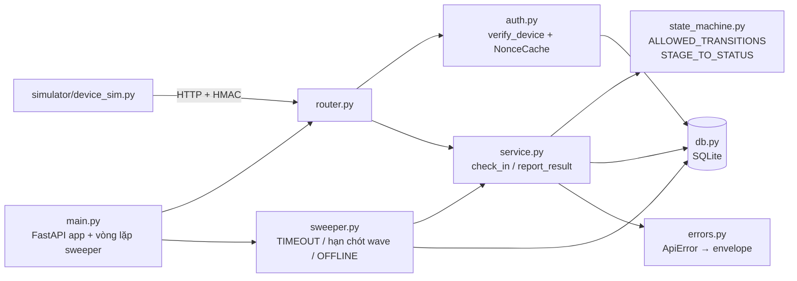

# CÁC QUYẾT ĐỊNH KỸ THUẬT TRONG CODE PROTOTYPE (DEVICE AGENT)
## ĐỀ BÀI: NỀN TẢNG TRIỂN KHAI CẬP NHẬT FIRMWARE (FIRMWARE ROLLOUT PLATFORM)
**Doanh nghiệp:** DASAN Vietnam · **Track:** System Design (OJT 2026 KITS Hanoi) · **Phụ trách:** Thành viên B

> Tài liệu ngắn cho người đọc code trong thư mục [`prototype/`](../../prototype/). Thiết kế nghiệp vụ (sơ đồ, máy trạng thái, idempotency) xem [DEVICE_AGENT_DESIGN.md](DEVICE_AGENT_DESIGN.md). Hướng dẫn cài đặt & chạy xem [prototype/README.md](../../prototype/README.md). Code bám quy ước chốt Q1–Q10 trong [DASAN_OJT1_Team_Role_Assignment.md](../../DASAN_OJT1_Team_Role_Assignment.md).

---

## 1. MỤC TIÊU & PHẠM VI PROTOTYPE

* **Mục tiêu:** chứng minh thiết kế phía thiết bị **chạy được và đúng**, phục vụ yêu cầu Điểm cộng số 15 của đề bài ("bản mẫu nhỏ chạy được cho một luồng").
* **Trong phạm vi:**
  * 2 endpoint `(*)` dành cho thiết bị: `POST /api/device-agent/check-in` và `POST /api/device-agent/tasks/{taskId}/result`.
  * Máy trạng thái `device_tasks`, retry/backoff, timeout theo `lastHeartbeatAt`, hạn chót wave, đối soát, idempotency.
  * Xác thực thiết bị bằng HMAC có nonce.
  * Bộ mô phỏng N thiết bị (jitter, Dual-Bank, Watchdog, tiêm lỗi).
* **Ngoài phạm vi** (thuộc thành viên khác, prototype chỉ dùng dữ liệu seed):
  * Tải lên / phê duyệt firmware: phần A.
  * Tạo campaign, chia wave, chuyển wave, auto-pause, khung giờ bảo trì: phần C.
  * JWT/RBAC cho người dùng, audit log, Mock API Skeleton tổng: phần D.

---

## 2. BẢNG QUYẾT ĐỊNH CODE

| Hạng mục | Quyết định được chọn | Phương án bị loại & Lý do loại trừ |
| :--- | :--- | :--- |
| **Ngôn ngữ / Framework** | **Python + FastAPI**: tự sinh Swagger (OpenAPI), khai báo DTO bằng Pydantic, code ngắn để người chấm đọc nhanh. Khớp lựa chọn "FastAPI hoặc Node.js" của Mock API (phần D). | *Loại: ASP.NET / Spring Boot* vì nhiều boilerplate so với một prototype nhỏ; đề bài không ràng buộc ngôn ngữ. |
| **Cơ sở dữ liệu** | **SQLite qua module `sqlite3` chuẩn**, viết SQL tường minh. Tên bảng/cột/enum giữ đúng ERD chung. | *Loại: ORM (SQLAlchemy)* vì che mất các câu lệnh mà nhóm cần trình bày: partial unique index, UPDATE có điều kiện. *Loại: PostgreSQL* vì bắt người chạy thử phải cài thêm; mọi ràng buộc dùng ở đây đều có tương đương trên PostgreSQL. |
| **Mốc thời gian của task** | Chỉ dùng `lastHeartbeatAt` (đúng ERD): timeout = `lastHeartbeatAt` + hạn theo trạng thái; retry được giao lại khi `now ≥ lastHeartbeatAt + backoff[attempt-2]`. | *Loại: thêm cột `stateEnteredAt`, `nextEligibleAt`* vì lệch ERD chung và phải giữ đồng bộ 3 cột thời gian. |
| **Chống ghi đè đồng thời** | **Optimistic Locking:** mọi UPDATE `device_tasks` có `WHERE status = <cũ> AND attemptCount = <cũ>`; không đúng 1 dòng bị ảnh hưởng → 409 `CONCURRENT_MODIFICATION`. | *Loại: khóa bi quan toàn bảng* vì chặn cả các thiết bị không liên quan. *Loại: không kiểm tra* vì API và Worker có thể cùng sửa 1 task. |
| **Transaction** | `BEGIN IMMEDIATE` cho mỗi request ghi (`db.transaction()`), tuần tự hóa bước "đếm slot tải" và "nhận task". | *Loại: autocommit từng câu* vì có thể vượt `maxConcurrentDevices` khi 2 thiết bị check-in cùng lúc. Production: Redis Semaphore (phần C). |
| **1 thiết bị chỉ 1 task đang chạy** | **Partial Unique Index** ở tầng DB (`db.py`), cùng câu lệnh với tài liệu của C. | *Loại: kiểm tra trong code* vì 2 request song song đều có thể qua bước kiểm tra trước khi một bên kịp ghi. |
| **Lịch sử firmware không trùng** | `UNIQUE(device_firmware_histories.taskId)` + `INSERT OR IGNORE`. | *Loại: kiểm tra tồn tại rồi mới insert* vì có race tương tự. |
| **Slot tải (Q6)** | Chỉ đếm task `DOWNLOADING` của campaign bằng SQL; `DOWNLOADED` / `FAILED` / `TIMEOUT` ở bước tải tự động trả slot vì task rời trạng thái `DOWNLOADING`. | *Hoãn: Redis Semaphore `sem:campaign:{id}`* (thiết kế production của C) vì prototype không muốn phụ thuộc Redis; cách đếm DB chính là phương án fallback C đã nêu khi Redis gặp sự cố. |
| **Trường `stage` (Q5)** | Bảng `STAGE_TO_STATUS` trong `state_machine.py`: `DOWNLOADED → INSTALLING`, `INSTALLING → INSTALLING` (heartbeat), các stage còn lại giữ tên. | *Loại: để thiết bị gửi thẳng tên trạng thái* vì thiết bị không được tự đặt `DOWNLOADING`/`TIMEOUT`, và cần phân biệt "tải xong" với "đang cài". |
| **Báo trùng** | Không đổi trạng thái, chỉ cập nhật `lastHeartbeatAt` khi task đang chạy; riêng `FAILED` của lượt cũ không chạm heartbeat để không đẩy lùi backoff. | *Loại: bỏ qua hoàn toàn* vì Q5 yêu cầu mỗi lần gọi cập nhật heartbeat. |
| **So sánh phiên bản (Q8)** | So `firmware_versions.versionCode` (INT) của bản thiết bị đang chạy với `minRequiredVersionCode` của bản đích. Bản thiết bị báo lên không có trong DB → coi là không tương thích. | *Loại: so sánh chuỗi* vì `"2.10.0" < "2.9.0"` theo thứ tự chuỗi. |
| **Chống replay** | HMAC ký `serialNo, timestamp, nonce, METHOD, PATH, SHA256(body)`; nonce đã dùng lưu trong `NonceCache` (bộ nhớ, 10 phút) và chỉ ghi nhận **sau** khi chữ ký hợp lệ. | *Loại: chỉ dùng timestamp* vì vẫn phát lại được trong cửa sổ 5 phút. Production: Redis `SET NX EX` để mọi instance API dùng chung. |
| **Pre-signed URL** | Sinh URL **giả** có `expires` + `sig`, hết hạn sau 15 phút (bằng timeout tải); backend không bao giờ truyền file. | *Loại: tích hợp MinIO thật* vì không phải trọng tâm phần B; chỉ cần chứng minh API chỉ trả metadata + link. |
| **Máy trạng thái tách riêng** | `state_machine.py` thuần logic (không DB, không HTTP), bảng `ALLOWED_TRANSITIONS` khai báo tập trung. | *Loại: rải `if status == ...` trong service* vì khó đối chiếu với sơ đồ và khó test. File này khớp 1-1 với sơ đồ ở DEVICE_AGENT_DESIGN mục 3. |
| **Định dạng phản hồi** | Thống nhất `{ "status", "message", "data" }` cho cả lỗi; lỗi validate trả **400** (không phải 422 mặc định của FastAPI); không có việc trả `action: "NO_TASK"`. | Theo yêu cầu đề bài Bước 3 và cách gọi trong tài liệu của C. |
| **Thời gian** | Lưu chuỗi ISO-8601 UTC độ dài cố định để so sánh chuỗi đúng thứ tự trong SQLite; mọi chỗ lấy giờ gọi `timeutil.now()` để test giả lập đồng hồ. | *Loại: `datetime('now')` trong SQL* vì không điều khiển được trong test timeout/backoff. |
| **Tua nhanh khi demo** | Biến môi trường `DASAN_TIME_SCALE` chia mọi khoảng thời gian (chu kỳ check-in, timeout, backoff, hạn chót wave), riêng cửa sổ HMAC giữ thời gian thật. | *Loại: sửa tay hằng số khi demo* vì dễ quên trả lại; server và simulator có thể lệch nhau. |
| **Simulator** | `asyncio` + `httpx` gọi server qua **HTTP thật**, đọc serial/secret từ DB seed (tương đương nạp secret lúc xuất xưởng). | *Loại: gọi thẳng hàm service* vì bỏ qua tầng xác thực và serialize, không chứng minh được hành vi end-to-end. |

---

## 3. SƠ ĐỒ MODULE & LUỒNG GỌI



| File | Vai trò |
| :--- | :--- |
| `config.py` | Mọi hằng số: chu kỳ 300s, jitter 30s, timeout 15/10/5 phút, 3 lượt, backoff 1/5/15 phút, hạn chót wave 24h, cửa sổ HMAC 300s |
| `state_machine.py` | Enum trạng thái, enum `Stage`, bảng chuyển hợp lệ, các nhóm `ACTIVE` / `IN_PROGRESS` / `DOWNLOAD_SLOT` / `TERMINAL` / `FAILURE` |
| `db.py` | Schema (tập con ERD chung + bảng `device_credentials`), index, `transaction()`, `get_db()` |
| `auth.py` | `sign()` / `signed_headers()` dùng chung cho server, test, simulator; `verify_device()` là FastAPI dependency |
| `service.py` | Toàn bộ nghiệp vụ; mọi ghi đều qua `_update_task()` (optimistic lock) và `_fail_or_retry()` (retry/backoff) |
| `sweeper.py` | `sweep_timeouts(conn, now)`: quét heartbeat quá hạn, hạn chót wave, đánh dấu thiết bị OFFLINE |
| `router.py` | 2 endpoint, chỉ chuyển request → service, không chứa logic |
| `seed.py` | 3 bản firmware (1.9.0 / 2.3.0 / 2.4.1, có `versionCode`), 50 thiết bị, 1 campaign 2 wave có `deadlineAt`; dữ liệu hoàn toàn giả lập |

---

## 4. TÍCH HỢP VÀO MOCK API SKELETON (THÀNH VIÊN D)

```python
from device_agent.router import router as device_agent_router
from device_agent.errors import install_error_handlers

install_error_handlers(app)          # nếu skeleton chưa có handler định dạng chung
app.include_router(device_agent_router)
```
* Router không phụ thuộc JWT của người dùng; dependency `verify_device` tự xác thực bằng HMAC.
* Nếu skeleton dùng DB khác (PostgreSQL/ORM): chỉ cần thay `db.get_db()` và câu SQL trong `service.py`; `state_machine.py` dùng lại nguyên vẹn.

---

## 5. KIỂM THỬ

* **64 test** (`pytest`), chạy cục bộ trước khi đẩy code, **không đưa lên repo** (thư mục `prototype/tests/` nằm trong `.gitignore`). Phạm vi kiểm thử:
  * Máy trạng thái: mọi cạnh hợp lệ/không hợp lệ, trạng thái cuối, ánh xạ `stage`, slot tải.
  * Xác thực: thiếu header/nonce, sai secret, sửa body, đổi nonce, phát lại cùng nonce, request quá 5 phút, serial giả, chữ ký không dùng chéo endpoint.
  * Check-in: giao task, chặn theo wave/campaign/backoff/DEPRECATED/slot tải, trả slot khi `DOWNLOADED` hoặc lỗi tải, hạn chót wave, không tương thích, đối soát SUCCESS/ROLLED_BACK.
  * Idempotency: báo trùng chỉ làm mới heartbeat, đi lùi, attempt cũ, retry/backoff, hết lượt, SUCCESS muộn, DB chặn 2 task đang chạy.
  * Worker quét: timeout theo từng trạng thái, retry, TIMEOUT cuối rồi đối soát SUCCESS, hạn chót wave không ảnh hưởng thiết bị đang cài, đánh dấu OFFLINE.
* **Mô phỏng end-to-end:** 50 thiết bị, tua nhanh x60 trong 45 giây.
  * Kết quả: 46 `SUCCESS`, 2 `ROLLED_BACK`, 2 `FAILED (INCOMPATIBLE)`.
  * 4 lượt tải bị ngắt đều được retry thành công.
  * 19 báo cáo gửi lại được nhận là trùng, 0 lỗi 409.
  * Khoảng cách check-in trung bình 307s (min 271s).

---

## 6. GIỚI HẠN CỦA PROTOTYPE & HƯỚNG NÂNG CẤP PRODUCTION

| Giới hạn hiện tại | Hướng nâng cấp |
| :--- | :--- |
| SQLite, 1 process, `BEGIN IMMEDIATE` tuần tự hóa mọi ghi | PostgreSQL + partition `device_tasks` theo thời gian; khóa theo dòng campaign |
| `lastCheckInAt` ghi thẳng DB mỗi lần check-in | Ghi Redis, worker gom batch 30-60s (spec §4) |
| Đếm slot tải bằng SQL | Redis Semaphore `sem:campaign:{id}` (phần C); giữ đếm SQL làm fallback |
| Nonce lưu trong bộ nhớ 1 process | Redis `SET NX EX` dùng chung cho mọi instance API |
| Sweeper chạy trong process API | Worker riêng (Celery/Hangfire) + distributed lock để chỉ 1 instance quét |
| Secret HMAC lưu dạng rõ trong bảng | Lưu trong HSM/KMS, hoặc chuyển sang mTLS với chứng chỉ riêng từng thiết bị |
| Chưa ghi `audit_logs` (`actorType = DEVICE/SYSTEM`) cho sự kiện thiết bị | Ghi chuyển trạng thái quan trọng (ROLLED_BACK, TIMEOUT cuối) vào `audit_logs` theo thiết kế của D |
| Chưa áp khung giờ bảo trì (#14) | C bổ sung điều kiện trả `NO_TASK` trong `service.check_in` sau khi chốt dạng cột |
| Không lưu chi tiết từng lượt lỗi (chỉ giữ `errorCode` cuối) | Bảng `device_task_attempts` nếu cần phân tích lỗi cho tính năng AI (phương án C) |
| URL tải firmware giả | Pre-signed URL thật của S3/MinIO + CDN |
