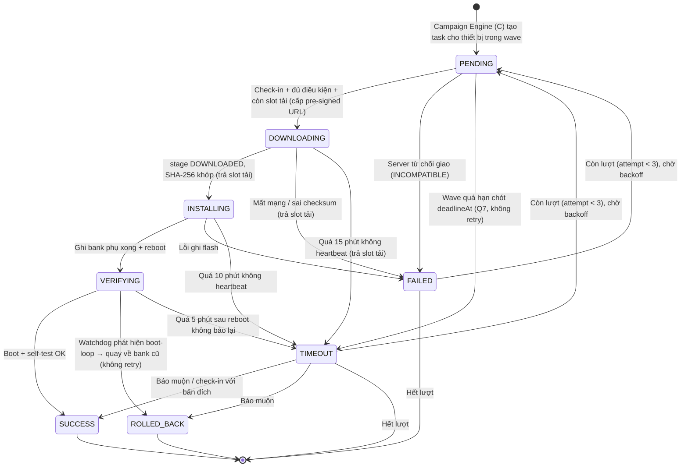
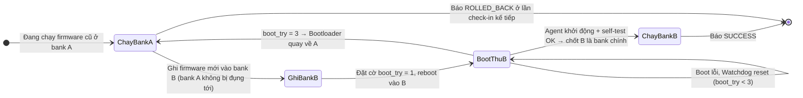

# THIẾT KẾ PHÍA THIẾT BỊ (DEVICE AGENT & EDGE PROTOCOL)
## ĐỀ BÀI: NỀN TẢNG TRIỂN KHAI CẬP NHẬT FIRMWARE (FIRMWARE ROLLOUT PLATFORM)
**Doanh nghiệp:** DASAN Vietnam · **Track:** System Design (OJT 2026 KITS Hanoi) · **Phụ trách:** Thành viên B

> Tài liệu này chi tiết hóa phần của Thành viên B trong [DASAN_OJT1_System_Design_Specification.md](../../DASAN_OJT1_System_Design_Specification.md) và [DASAN_OJT1_Team_Role_Assignment.md](../../DASAN_OJT1_Team_Role_Assignment.md): cơ chế PULL + Random Jitter, Luồng 2 — Check-in & Update, máy trạng thái Device Task, Dual-Bank A/B + Watchdog và tính lũy đẳng. Mọi tên bảng, trạng thái, mốc thời gian bám đúng **quy ước chốt Q1–Q10**; điểm bổ sung được đánh dấu **[Đề xuất]** và liệt kê ở mục 7.

---

## 1. QUYẾT ĐỊNH THIẾT KẾ & ĐÁNH ĐỔI (PHẠM VI THIẾT BỊ)

| Hạng mục | Quyết định kỹ thuật được chọn | Phương án bị loại & Lý do loại trừ |
| :--- | :--- | :--- |
| **Cơ chế giao tiếp** | **PULL thuần túy**: thiết bị gọi `POST /api/device-agent/check-in` mỗi 5 phút, cộng **Random Jitter ±30s**. Server trả kèm `nextCheckInSeconds` để có thể giãn chu kỳ khi quá tải. | *Loại: PUSH* vì thiết bị nằm sau NAT/Firewall của ISP, IP động, server không mở được kết nối vào. *Loại: Hybrid (MQTT/TR-069 giữ kết nối)* vì giữ 100.000 kết nối thường trực tốn tài nguyên trong khi độ trễ ≤ 5 phút đã đủ cho bài toán cập nhật firmware. |
| **Random Jitter** | Mỗi chu kỳ thiết bị ngủ `interval ± random(30s)`; lần bật máy đầu tiên ngủ ngẫu nhiên trong `[0, interval]`. | *Loại: chu kỳ cố định* vì sau một sự cố mất điện diện rộng, hàng chục nghìn thiết bị khởi động cùng lúc sẽ check-in đồng bộ mãi mãi (Thundering Herd). |
| **Báo tiến độ (Q5)** | Dùng chung endpoint `POST /tasks/{taskId}/result` với trường **`stage`**: trung gian `DOWNLOADED`, `INSTALLING`, `VERIFYING` và kết quả cuối `SUCCESS`, `FAILED`, `ROLLED_BACK`. Mỗi lần gọi cập nhật `lastHeartbeatAt`. | *Loại: thêm endpoint `/progress` riêng* vì tăng bề mặt API mà không thêm giá trị; *Loại: báo tiến độ qua check-in* vì chu kỳ 5 phút quá thưa để biết thiết bị kẹt ở bước nào. |
| **Xác thực thiết bị** | **HMAC-SHA256(`serialNo + timestamp + nonce`)** theo quy ước nhóm, ký thêm `METHOD`, `PATH`, `SHA256(body)`; secret nạp lúc xuất xưởng. Lệch giờ > 5 phút hoặc nonce đã dùng → 401. (mTLS là phương án production tương đương.) | *Loại: JWT như người dùng* vì thiết bị không có phiên đăng nhập; token bị lộ dùng lại được tới khi hết hạn, còn chữ ký HMAC gắn với từng request và từng nonce. |
| **An toàn khi flash** | **Dual-Bank A/B + Hardware Watchdog**: ghi vào bank không hoạt động, boot thử, Watchdog quay về bank cũ sau 3 lần boot lỗi. | *Loại: Single-Bank + Recovery ROM* vì mất điện giữa lúc ghi flash sẽ làm thiết bị "brick", phải cử kỹ sư đến nhà khách hàng. |
| **Tính lũy đẳng** | Khóa theo **`(taskId, attemptCount, stage)`**; báo trùng không đổi trạng thái, chỉ làm mới heartbeat, trả 200 kèm trạng thái hiện tại. Mọi UPDATE có điều kiện `WHERE status = <trạng thái mong đợi>`. | *Loại: Idempotency-Key lưu bảng riêng* vì bộ ba trên đã đủ định danh duy nhất một báo cáo, không cần thêm bảng. |
| **Đối soát (Reconcile)** | Phiên bản firmware thiết bị đang chạy là "sự thật cuối cùng": check-in với `currentVersion` = bản đích → `SUCCESS`; đang `VERIFYING` mà check-in với bản cũ → `ROLLED_BACK`. | *Loại: chỉ tin báo cáo `result`* vì báo cáo có thể mất vĩnh viễn (thiết bị reboot đúng lúc gửi), task sẽ treo tới khi TIMEOUT dù thiết bị đã cập nhật xong. |
| **Một mốc thời gian duy nhất** | Chỉ dùng `device_tasks.lastHeartbeatAt` (đúng ERD chung) để tính cả **timeout** (task đang chạy) lẫn **backoff** (task `PENDING` chờ retry). | *Loại: thêm cột `stateEnteredAt`, `nextEligibleAt`* vì tạo thêm dữ liệu phải giữ đồng bộ; cả hai đều suy ra được từ `lastHeartbeatAt` + `attemptCount`. |

---

## 2. SƠ ĐỒ TUẦN TỰ: LUỒNG 2 — CHECK-IN & UPDATE

```mermaid
sequenceDiagram
    autonumber
    participant D as Thiết bị (Device Agent)
    participant API as Device Ingestion API
    participant RD as Redis (Semaphore / Nonce)
    participant DB as Database
    participant S3 as Object Storage / CDN

    loop Mỗi 300s ± 30s (Random Jitter)
        D->>API: POST /check-in {serialNo, model, currentVersion, activePartition} + HMAC(serial, timestamp, nonce)
        API->>RD: Kiểm tra nonce chưa dùng (đã dùng → 401)
        API->>DB: Cập nhật lastCheckInAt, connectivity = ONLINE
        API->>DB: Đối soát task đang chạy theo currentVersion
        alt Không có task / campaign PAUSED / đang backoff / wave quá hạn / hết slot tải
            API-->>D: 200 {action: NO_TASK, nextCheckInSeconds}
        else Có task PENDING đủ điều kiện
            API->>RD: Xin 1 slot sem:campaign:{id}
            API->>DB: UPDATE task SET status = DOWNLOADING WHERE status = PENDING (optimistic lock)
            API-->>D: 200 {action: UPDATE, task: {taskId, attempt, downloadUrl (pre-signed 15'), checksum}}
        end
    end

    D->>S3: GET downloadUrl (tải trực tiếp ~50MB, không qua API)
    D->>D: Kiểm tra SHA-256
    alt Mất mạng / sai checksum
        D->>API: POST /tasks/{id}/result {attempt, stage: FAILED, errorCode}
        API->>RD: Trả slot tải
        API->>DB: Còn lượt → PENDING (attempt+1, chờ backoff 1' → 5' → 15')
    else Checksum khớp
        D->>API: POST /tasks/{id}/result {stage: DOWNLOADED}
        API->>RD: Trả slot tải (Q6)
        API->>DB: task = INSTALLING
        D->>D: Ghi firmware vào bank KHÔNG hoạt động (gửi stage INSTALLING làm heartbeat)
        D->>API: POST /tasks/{id}/result {stage: VERIFYING}
        D->>D: Reboot vào bank mới, Watchdog giám sát
        alt Boot OK + self-test OK
            D->>API: POST /tasks/{id}/result {stage: SUCCESS, reportedVersion = bản mới}
            API->>DB: task = SUCCESS, devices.currentFirmwareId, ghi device_firmware_histories (1 transaction)
        else Boot lỗi 3 lần
            D->>D: Bootloader quay về bank cũ
            D->>API: POST /tasks/{id}/result {stage: ROLLED_BACK, errorCode: ERR_WATCHDOG_BOOT_TIMEOUT}
            API->>DB: task = ROLLED_BACK (tính vào FailureRate cho auto-pause của C)
        end
    end
    Note over API,DB: Worker quét lastHeartbeatAt: quá hạn → TIMEOUT → retry hoặc kết thúc; wave quá deadlineAt → task PENDING thành TIMEOUT
```

---

## 3. MÁY TRẠNG THÁI: DEVICE TASK



### 3.1. Ai/cái gì kích hoạt từng chuyển trạng thái

| Chuyển trạng thái | Tác nhân kích hoạt |
| :--- | :--- |
| `PENDING → DOWNLOADING` | **Server**, khi thiết bị check-in và qua đủ điều kiện |
| `PENDING → FAILED` | **Server**, firmware không tương thích (sai model / `versionCode` < `minRequiredVersionCode`) |
| `PENDING → TIMEOUT` | **Worker**, wave quá `deadlineAt` mà task chưa bắt đầu |
| `DOWNLOADING → INSTALLING → VERIFYING → SUCCESS` | **Thiết bị** báo `stage` qua `/result` |
| `* → FAILED`, `VERIFYING → ROLLED_BACK` | **Thiết bị** báo `stage` qua `/result` |
| `DOWNLOADING/INSTALLING/VERIFYING → TIMEOUT` | **Worker**, quét `lastHeartbeatAt` |
| `FAILED/TIMEOUT → PENDING` | **Server**, ngay trong cùng transaction ghi nhận lỗi |
| `* → SUCCESS` / `VERIFYING → ROLLED_BACK` (đối soát) | **Server**, suy ra từ `currentVersion` lúc check-in |

### 3.2. Timeout & chính sách thử lại (quy ước Q9)

| Trạng thái | Hạn chót (tính từ `lastHeartbeatAt`) | Lý do |
| :--- | :--- | :--- |
| `DOWNLOADING` | **15 phút** | Bằng thời hạn pre-signed URL; 50MB ở băng thông xấu 0,5 MB/s mất ~2 phút, dư nhiều lần |
| `INSTALLING` | **10 phút** | Ghi flash 50MB mất < 1 phút; thiết bị gửi heartbeat `INSTALLING` trong lúc ghi |
| `VERIFYING` | **5 phút** | Đủ cho Watchdog thử boot tối đa 3 lần + self-test |

* **Số lượt tối đa:** 3 (tính cả lượt đầu). Mỗi lượt lỗi tăng `attemptCount`.
* **Backoff:** 1 phút → 5 phút → 15 phút. Task `PENDING` lượt `n ≥ 2` chỉ được giao lại khi `now ≥ lastHeartbeatAt + backoff[n-2]` (`lastHeartbeatAt` lúc này là thời điểm ghi nhận lỗi).
* **`ROLLED_BACK` không thử lại:** lỗi nằm ở chính bản firmware/phần cứng chứ không phải đường truyền; thử lại chỉ làm khách hàng mất mạng thêm lần nữa.
* **Thời điểm quay về bản cũ:** do **thiết bị tự quyết** (Watchdog), không chờ lệnh server, vì lúc boot-loop thiết bị không liên lạc được với server.
* **Firmware cũ được giữ nguyên** ở bank đang chạy cho đến khi `VERIFYING` thành công (Yêu cầu Cốt lõi #5).

---

## 4. DUAL-BANK A/B + HARDWARE WATCHDOG



* **Mất điện lúc đang ghi bank B:** bank A còn nguyên → thiết bị boot lại bình thường với firmware cũ, báo `FAILED` hoặc bị worker đánh `TIMEOUT` rồi retry.
* **Bản mới khởi động lại liên tục:** Watchdog đếm `boot_try`, sau 3 lần bootloader chọn lại bank A → thiết bị vẫn online, khách hàng không mất Internet quá vài phút.
* **Bản mới không vượt qua xác minh** (boot được nhưng self-test hỏng, ví dụ mất kết nối WAN): agent tự hạ cờ và reboot về bank A → `ROLLED_BACK`.
* **Hệ quả lên dữ liệu:** `devices.activePartition` (đã có trong ERD chung) lưu bank đang chạy, giúp hỗ trợ kỹ thuật biết thiết bị đang ở bank nào.

---

## 5. TÍNH LŨY ĐẲNG (IDEMPOTENCY)

| Tình huống | Cách xử lý | Cơ chế bảo đảm |
| :--- | :--- | :--- |
| Thiết bị check-in 2 lần khi đang có task | Trả lại **đúng task + attempt đó**, không tạo task mới | **Partial Unique Index** `device_tasks(deviceId) WHERE status IN (PENDING, DOWNLOADING, INSTALLING, VERIFYING)` |
| Gửi lại báo cáo cùng `stage` (mất phản hồi), hoặc `INSTALLING` sau `DOWNLOADED` | 200, `duplicate: true`; **không đổi trạng thái**, không tăng biến đếm, chỉ làm mới `lastHeartbeatAt` | So sánh trạng thái hiện tại trước khi UPDATE |
| Gửi `SUCCESS` nhiều lần | Lịch sử firmware chỉ có 1 dòng | `UNIQUE(device_firmware_histories.taskId)` |
| Gửi lại `FAILED` của lượt đã được retry | 200, `duplicate: true`; **không** chạm `lastHeartbeatAt` để không đẩy lùi backoff | `attempt` < `attemptCount` hiện tại |
| Báo tiến độ của lượt cũ | **409** `STALE_ATTEMPT` | So sánh `attempt` |
| Báo đi lùi (`VERIFYING` → `DOWNLOADED`) hoặc kết quả cuối mâu thuẫn (`ROLLED_BACK` rồi `SUCCESS`) | **409** `INVALID_TRANSITION` | Bảng chuyển trạng thái |
| Hai tiến trình cùng cập nhật 1 task (API + Worker) | Chỉ một bên thắng, bên kia nhận 409 / bỏ qua | `UPDATE ... WHERE id = ? AND status = <cũ> AND attemptCount = <cũ>` (Optimistic Locking) |
| Hai Operator start 2 campaign chứa cùng thiết bị | Task thứ 2 không thể tạo | Partial Unique Index ở trên + Distributed Lock theo `targetGroupId` (phần C) |
| Thiết bị báo `SUCCESS` sau khi server đã đánh `TIMEOUT` và retry | Chấp nhận nếu `reportedVersion` khớp bản đích | Đối soát theo phiên bản (mục 1) |
| Kẻ xấu bắt được 1 request hợp lệ và gửi lại | **401** `NONCE_REUSED` (trong 5 phút) hoặc `TIMESTAMP_OUT_OF_WINDOW` (sau 5 phút) | Nonce + timestamp nằm trong chữ ký HMAC |

---

## 6. PHÁC THẢO 2 ENDPOINT DÀNH CHO THIẾT BỊ (*)

### 6.1. `POST /api/device-agent/check-in`

**Header:** `X-Device-Serial`, `X-Timestamp` (Unix giây), `X-Nonce` (dùng 1 lần), `X-Signature` (HMAC-SHA256 hex)

**Request:**
```json
{ "serialNo": "DSN-H660-0001", "model": "DASAN-H660GM", "currentVersion": "2.3.0", "activePartition": "A" }
```

**Response 200 (có việc):**
```json
{
  "status": 200, "message": "success",
  "data": {
    "action": "UPDATE",
    "task": {
      "taskId": "9b1c...", "attempt": 1, "taskStatus": "DOWNLOADING", "toVersion": "2.4.1",
      "downloadUrl": "https://cdn.example.local/firmware/DASAN-H660GM/2.4.1.bin?...&expires=...&sig=...",
      "urlExpiresAt": "2026-11-23T02:15:00.000000Z",
      "checksum": "e3b0c442...", "stateDeadlineAt": "2026-11-23T02:15:00.000000Z"
    },
    "nextCheckInSeconds": 300, "serverTime": "2026-11-23T02:00:00.000000Z"
  }
}
```

**Response 200 (không có việc):** `{"status": 200, "message": "success", "data": {"action": "NO_TASK", "task": null, "nextCheckInSeconds": 300, ...}}`

| Mã | Khi nào |
| :--- | :--- |
| 200 | Luôn trả khi xác thực hợp lệ (`UPDATE` hoặc `NO_TASK`) |
| 400 | Body sai định dạng / `model` không khớp dữ liệu đăng ký |
| 401 | Thiếu header, chữ ký sai, timestamp lệch > 5 phút, nonce đã dùng, serial không tồn tại (cố ý không trả 404 để không lộ serial nào có thật) |
| 403 | `serialNo` trong body khác thiết bị đã ký request |

### 6.2. `POST /api/device-agent/tasks/{taskId}/result`

**Request:**
```json
{ "attempt": 1, "stage": "ROLLED_BACK", "reportedVersion": "2.3.0", "activePartition": "A",
  "errorCode": "ERR_WATCHDOG_BOOT_TIMEOUT", "errorMessage": "Watchdog: 3 lần boot lỗi trên bank B" }
```
`stage` ∈ `DOWNLOADED | INSTALLING | VERIFYING | SUCCESS | FAILED | ROLLED_BACK` (`PENDING`, `DOWNLOADING`, `TIMEOUT` chỉ server đặt).

| `stage` thiết bị gửi | Trạng thái task sau khi server xử lý |
| :--- | :--- |
| `DOWNLOADED` | `INSTALLING` (trả slot tải) |
| `INSTALLING` | `INSTALLING` (heartbeat) |
| `VERIFYING` | `VERIFYING` |
| `SUCCESS` / `ROLLED_BACK` | Giữ nguyên tên |
| `FAILED` | `PENDING` (còn lượt, kèm `nextEligibleAt`) hoặc `FAILED` (hết lượt) |

**Response 200:**
```json
{ "status": 200, "message": "success",
  "data": { "taskId": "9b1c...", "status": "ROLLED_BACK", "attempt": 1, "duplicate": false, "nextEligibleAt": null } }
```
Báo trùng → `message = "duplicate"`, `data.duplicate = true`, `data.status` là trạng thái hiện tại.

| Mã | Khi nào |
| :--- | :--- |
| 200 | Ghi nhận thành công hoặc báo trùng (chỉ cập nhật heartbeat) |
| 400 | Body sai định dạng / `stage` không thuộc danh sách |
| 401 | Lỗi xác thực HMAC (như check-in) |
| 403 | Task không thuộc thiết bị đã ký request |
| 404 | Không có task |
| 409 | `INVALID_TRANSITION`, `STALE_ATTEMPT`, `VERSION_MISMATCH`, `CONCURRENT_MODIFICATION` |

### 6.3. Vì sao endpoint thiết bị xác thực khác endpoint quản trị
* Người dùng có phiên đăng nhập → **JWT + RBAC** phù hợp. Thiết bị không có người đăng nhập, chỉ có danh tính phần cứng → **secret/chứng chỉ nạp lúc xuất xưởng**.
* Hai nhóm endpoint tách prefix (`/api/device-agent/*`) nên API Gateway áp chính sách khác nhau: rate-limit theo serial, không cấp quyền quản trị cho bất kỳ thiết bị nào.
* Lộ secret của 1 thiết bị chỉ ảnh hưởng đúng thiết bị đó, không ảnh hưởng toàn hệ thống như lộ khóa ký JWT.

---

## 7. CÁC ĐIỂM ĐÃ CHỐT & CÒN MỞ

### 7.1. Đã chốt theo quy ước nhóm (đã áp dụng trong thiết kế và code)

| Quy ước | Áp dụng ở phần B |
| :--- | :--- |
| Q4 — FailureRate chỉ đếm trạng thái cuối | `FAILED`/`TIMEOUT` khi còn lượt được đưa ngay về `PENDING`, nên chỉ trạng thái cuối mới tồn tại trong DB |
| Q5 — trường `stage` + heartbeat mỗi lần gọi | Mục 6.2 |
| Q6 — slot tải trả khi `DOWNLOADED` / lỗi ở bước tải | Chỉ task `DOWNLOADING` chiếm slot |
| Q7 — hạn chót wave | Task `PENDING` thành `TIMEOUT` (`WAVE_DEADLINE_EXCEEDED`), không retry |
| Q8 — `versionCode` so sánh số | Điều kiện tương thích lúc giao task |
| Q9 — timeout 15'/10'/5', backoff 1'/5'/15' | Mục 3.2 |
| Xác thực `HMAC-SHA256(serialNo + timestamp + nonce)` | Mục 1, 6.1 |

### 7.2. Còn mở / đề xuất

| # | Nội dung | Cần chốt với | Đề xuất của B |
| :--- | :--- | :--- | :--- |
| 1 | Bổ sung bảng `device_credentials(deviceId, secret)` vào ERD | **A** | Thêm, tách khỏi `devices` để API quản trị không lộ secret |
| 2 | Q5 liệt kê cả `DOWNLOADED` và `INSTALLING`; sơ đồ `sequence_campaign_rollout` của C (bước 13) ghi `stage=INSTALLING` → trả token tải | **C** | Code chấp nhận **cả hai**: task đang `DOWNLOADING` nhận `DOWNLOADED` hoặc `INSTALLING` đều chuyển sang `INSTALLING` và trả slot; `INSTALLING` gửi sau đó chỉ là heartbeat. Đề nghị C ghi `stage=DOWNLOADED/INSTALLING` ở bước 13 cho khớp Q5 |
| 2b | Bước 14 sơ đồ của C: Campaign Worker "kiểm tra Timeout" | **C** | Timeout task do worker quét `lastHeartbeatAt` của B đảm nhận (`sweeper.py`); Campaign Worker của C chỉ đọc kết quả để tính FailureRate, tránh 2 worker cùng sửa 1 task |
| 3 | Chữ ký HMAC ký thêm `METHOD`, `PATH`, `SHA256(body)` ngoài `serialNo + timestamp + nonce` | **D** | Giữ, để body báo cáo không bị sửa trên đường truyền; ghi rõ vào spec |
| 4 | Campaign `ABORTED` thì task `PENDING` xử lý ra sao (enum không có `CANCELLED`) | **A, C** | Thêm `CANCELLED`; trong lúc chưa chốt, check-in trả `NO_TASK` cho task thuộc campaign không `RUNNING` |
| 5 | Khung giờ bảo trì (#14) chạy trong check-in: spec ghi `maintenanceWindow` (chuỗi), file phân công ghi `maintenanceWindowStart/End` | **A, C** | Chốt 1 dạng rồi C bổ sung điều kiện trả `NO_TASK` vào check-in |
| 6 | Cạnh `PENDING → TIMEOUT` (Q7) và `TIMEOUT → SUCCESS` (đối soát) chưa có trên sơ đồ trạng thái trong spec | **Cả nhóm** | Bổ sung vào `device_state_machine.drawio` |
